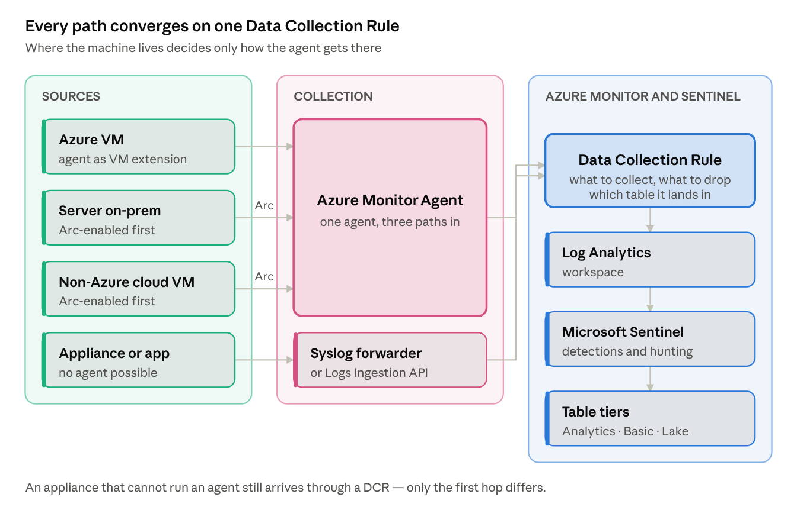
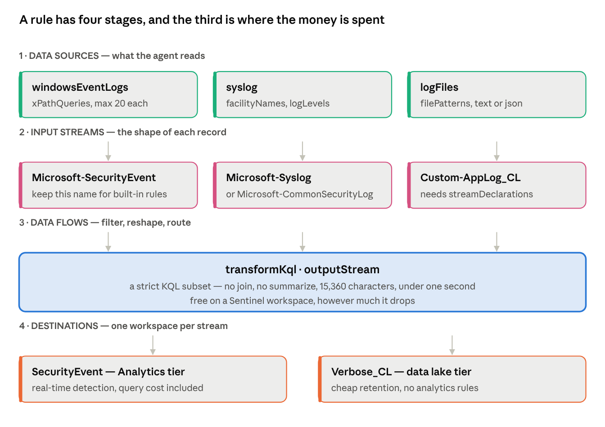
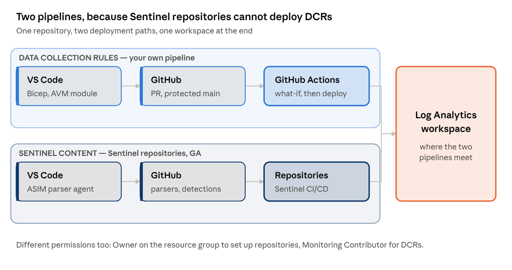

# Onboarding security logs to Microsoft Sentinel: Windows, Linux, on-prem

Every Windows and Linux log source reaching Microsoft Sentinel today goes through the same two objects — the Azure Monitor Agent and a Data Collection Rule — whether the machine sits in Azure, in your data centre, or in another cloud. This playbook covers the collection paths, the filtering and cost decisions, how to prove a source is actually complete, and how each setting maps to CIS, MCSB and DORA.

## Choosing the collection path



The only question that changes the design is whether the machine can run an agent. If it can, it runs the Azure Monitor Agent — directly on an Azure VM, or after Azure Arc projects an on-prem or other-cloud server into Azure as a resource. If it cannot, its logs reach a Linux forwarder running the agent, or arrive through the Logs Ingestion API.

Everything after that point is identical. The Data Collection Rule is where the real decisions live, and it is the object worth understanding before touching anything else.

## The model: agent, rule, endpoint

Installing the agent collects nothing. This is the most common cause of "the agent is healthy but no data arrives": the VM extension installs the agent and stops there, because a Data Collection Rule decides what is collected. Creating the DCR in the portal and adding the machine installs the agent and starts collection in one step, which is why that path is recommended.

The agent is `AzureMonitorWindowsAgent` or `AzureMonitorLinuxAgent`. The legacy Log Analytics agent (MMA) retired on 31 August 2024, and Microsoft's notice is blunter than most people realise: after 2 March 2026 data upload "can stop at any time without further notice." Any MMA still running is not a migration backlog item, it is a source that may already have stopped. The one exception is an agent connected exclusively to on-prem System Center Operations Manager.

A DCR has four stages — data sources, input streams, data flows, destinations — and these limits shape every design built on it:



| Limit | Value |
| --- | --- |
| Data sources per DCR | 10 |
| DCRs per machine | 30 |
| Machines per DCR | unlimited |
| Destination workspaces per stream, per DCR | 1 |
| DCR region | must match the destination workspace region |

So the working pattern is one DCR per log profile — `windows-security-baseline`, `linux-syslog-baseline`, `sysmon-endpoints` — associated to hundreds of machines through Azure Policy. The DCR can sit in a different subscription and resource group from the machines, as long as the tenant is the same.

Data Collection Endpoints are the exception, not the rule, and this is where older guidance misleads. A DCE is required only for Private Link, for any network sharing DNS with an Azure Monitor Private Link Scope, and for two specific sources: Windows Firewall logs and Prometheus metrics. **Custom text and JSON logs no longer need one.** Microsoft's own DCR samples page still shows `dataCollectionEndpointId` in its text-log example, which contradicts the DCE overview — expect that sample to be cited at you in a design review.

## Windows: Application, Security and System

The Windows Security Events connector is itself a DCR, and its presets are still the fastest defensible starting point:

| Preset | Scope |
| --- | --- |
| Minimal | 39 event IDs — account and group changes, process creation, policy change, AppLocker |
| Common | about 140 IDs — adds logon and logoff detail, Kerberos, directory service changes |
| All events | everything from the Security and AppLocker channels only |
| Custom | your own XPath |

Common is not a strict superset of Minimal: it adds 4634 (sign-out), which Minimal deliberately omits. All events covers the Security and AppLocker channels, so Application, System and Setup need their own data source.

The stream is `Microsoft-SecurityEvent` and the table is `SecurityEvent`. Keep that stream name if you hand-build the DCR, because most built-in analytics rules — including the near-real-time ones — query `SecurityEvent` and will not fire on anything else.

XPath is `LogName!XPathQuery`:

```
Security!*[System[(EventID=4648)]]
System!*[System[(Level=1 or Level=2 or Level=3) and (EventID != 6)]]
Security!*[System[(band(Keywords,13510798882111488)) and (EventID != 4624)]]
```

Test a query on the host before deploying it:

```powershell
$XPath = '*[System[EventID=1035]]'
Get-WinEvent -LogName 'Application' -FilterXPath $XPath
```

Four constraints bite in practice. XPath 1.0 only. `Get-WinEvent` accepts 23 expressions but a DCR accepts **20**, so a query that validates in PowerShell can still be rejected. `starts-with` and `contains` are not supported, while `position`, `band` and `timediff` are. And Analytic and Debug channels cannot be collected at all — the agent subscribes through the `EvtSubscribe` API, which Windows does not permit for those channel types.

Watch for double collection: a Sentinel connector and a separate DCR covering the same events on the same VM bills twice, as does a VM still running MMA alongside the Azure Monitor Agent.

## Sysmon, and the table it lands in

Sysmon writes to `Microsoft-Windows-Sysmon/Operational`. That is an Operational channel, so unlike Analytic and Debug it can be collected. The XPath is literal:

```
Microsoft-Windows-Sysmon/Operational!*
```

Narrow it in production — `Microsoft-Windows-Sysmon/Operational!*[System[(EventID=1 or EventID=3 or EventID=11)]]` for process creation, network connections and file creation.

The trap is the destination. Sysmon lands in `WindowsEvent`, not `SecurityEvent` and not `Event`. **Most built-in Sentinel analytics rules query `SecurityEvent` and will never fire on Sysmon data.** Teams discover this after the data is flowing and the detections are silent. Two fixes: install the ASIM Windows Event parsers and query through them, or rewrite the rule queries against `WindowsEvent`, which exposes a parsed `EventData` dynamic column plus `RawEventData` as fallback when parsing fails.

The same applies to Windows Event Forwarding. Forwarded Security-log events also land in `WindowsEvent`, never `SecurityEvent`, and the collector machine needs Windows Event Collector running with the agent installed on it.

One documentation inconsistency worth knowing before you hand-author anything: the DCR structure reference lists only `Microsoft-Event` for Windows event sources and never documents the stream that populates `WindowsEvent`. Generate the DCR through the Windows Forwarded Events connector in the portal, then read back its JSON and use that as your template.

Volume is the other consideration. EventID 3 (network connect) and 11 (file create) are high-rate, and `WindowsEvent` has no Basic plan support — though it does support the Auxiliary and data lake tiers.

## Linux: syslog, and what the agent rewrites

Linux collection filters on facility and severity. There are 24 facilities — kern, user, mail, daemon, auth, syslog, lpr, news, uucp, cron, authpriv, ftp, ntp, audit, alert, clock, local0 through local7 — and selecting a minimum severity collects that level and everything above it. For security monitoring, `auth` and `authpriv` are the baseline; `audit` carries auditd where it is configured to forward.

The agent rewrites the syslog daemon configuration on the host and restarts it. Know which files it owns before someone else edits them:

| Daemon | File |
| --- | --- |
| rsyslog, TCP | `/etc/rsyslog.d/10-azuremonitoragent-omfwd.conf` — forwards to `127.0.0.1:28330` |
| rsyslog, SELinux | `/etc/rsyslog.d/10-azuremonitoragent.conf` plus `/etc/rsyslog.d/05-azuremonitoragent-loadomuxsock.conf` |
| syslog-ng | `/etc/syslog-ng/conf.d/azuremonitoragent-tcp.conf` |

**The portal lies about what you are collecting.** The facility checkboxes in a DCR clear every time you reopen it and do not reflect the actual configuration. Always verify against the `facilityNames` property in the DCR JSON, not the UI.

Three more Linux-specific behaviours: semicolons are stripped during ingestion, so change them at source if they carry meaning; rsyslog inputs bound to a non-default ruleset are not forwarded to the agent at all; and a full disk stops the agent, so cap daemon-side retention on any host that also buffers locally.

Prerequisites that catch hardened builds: Python 2 or 3, the `which` and `initscripts` packages, and a system-wide crypto policy that is not `FUTURE` — check with `sudo update-crypto-policies --show`. Stripped-down custom distributions and locked appliances are unsupported. The agent creates a local `azuremonitoragent` account; do not remove it.

## On-prem and other clouds

Azure Arc projects a server into Azure as a resource with a full ARM resource ID, after which it behaves like an Azure VM for collection purposes: install the agent as an extension, associate DCRs, done. The agent is the Azure Connected Machine agent (`azcmagent`), it heartbeats every five minutes, and Arc itself costs nothing.

Onboarding at scale: service principal for non-interactive deployment, Group Policy for Windows estates, Ansible, Configuration Manager, Arc-enabled VMware vSphere, or the multicloud connector for AWS EC2.

Two constraints: the installer refuses to run on an Azure VM and rolls back, and the agent cannot be installed on a cloned machine that already has it — use Policy or infrastructure-as-code after cloning.

One side effect worth flagging to the server owners before you start. Arc-connecting a machine with SQL Server installed **automatically connects the SQL instances to Arc**, deploying an extension and applying new roles to the instances and their databases. Opt out with the tag `ArcSQLServerExtensionDeployment` set to `Disabled` at connect time.

### Appliances that cannot run an agent

A dedicated Linux forwarder running the agent plus rsyslog or syslog-ng. Appliances send to port 514, the daemon hands off to the agent on TCP 28330, and the agent ships to the workspace. Syslog lands in `Syslog`, CEF in `CommonSecurityLog`.

Microsoft publishes no sizing numbers for the forwarder — the documentation defers entirely to the agent performance benchmark, so any capacity figure in your design has to be your own measurement.

The standard design error here is duplicate ingestion: using the same facility for both Syslog and CEF bills the same events into both tables. Change the facility at source where you can. Where you cannot, filter in the DCR — and use both conditions, because from agent version 1.41 `ProcessName` became unreliable for vendors that do not follow RFC 3164 or 5424 headers:

```
source | where ProcessName !contains "CEF" and SyslogMessage !contains "CEF:0"
```

### Logstash

Still supported, currently v2.5.0, and it writes through the Logs Ingestion API with a DCE and DCR rather than the retired HTTP Data Collector API. Note that DCR-based ingestion through the plugin is public preview with no SLA, and that the older `connect-logstash` article is explicitly deprecated — the two are easy to confuse.

## Worked configurations

These are the three DCRs that cover most of an estate. Deploy them as JSON, not through the portal, for the reason in the traps list.

### Windows security events

The stream must stay `Microsoft-SecurityEvent` for built-in analytics rules to work. `xPathQueries` here is the Minimal preset expressed explicitly, so you can see and version what you are collecting rather than trusting a dropdown.

```json
{
  "location": "westeurope",
  "kind": "Windows",
  "properties": {
    "dataSources": {
      "windowsEventLogs": [
        {
          "name": "securityBaseline",
          "streams": [ "Microsoft-SecurityEvent" ],
          "xPathQueries": [
            "Security!*[System[(EventID=1102 or EventID=4624 or EventID=4625 or EventID=4657 or EventID=4663 or EventID=4688)]]",
            "Security!*[System[(EventID=4700 or EventID=4702 or EventID=4719 or EventID=4720 or EventID=4722 or EventID=4723)]]",
            "Security!*[System[(EventID=4724 or EventID=4727 or EventID=4728 or EventID=4732 or EventID=4735 or EventID=4737)]]",
            "Security!*[System[(EventID=4739 or EventID=4740 or EventID=4754 or EventID=4755 or EventID=4756 or EventID=4767)]]",
            "Security!*[System[(EventID=4799 or EventID=4825 or EventID=4946 or EventID=4948 or EventID=4956 or EventID=5024)]]",
            "Security!*[System[(EventID=5033 or EventID=8222)]]",
            "Microsoft-Windows-AppLocker/EXE and DLL!*[System[(EventID >= 8001 and EventID <= 8007)]]"
          ]
        }
      ]
    },
    "destinations": {
      "logAnalytics": [
        {
          "name": "sentinelWorkspace",
          "workspaceResourceId": "/subscriptions/<sub>/resourceGroups/<rg>/providers/Microsoft.OperationalInsights/workspaces/<ws>"
        }
      ]
    },
    "dataFlows": [
      {
        "streams": [ "Microsoft-SecurityEvent" ],
        "destinations": [ "sentinelWorkspace" ],
        "outputStream": "Microsoft-SecurityEvent"
      }
    ]
  }
}
```

Split across several `xPathQueries` entries deliberately: each entry counts its own expressions against the limit of 20, so one query holding forty event IDs is rejected while six short ones are not.

### Sysmon and other operational channels

Separate DCR, because this lands in `WindowsEvent` and carries different volume. Scope it to the event IDs you have detections for — 1, 3, 7, 8, 10, 11, 22 is a defensible starting set.

```json
{
  "location": "westeurope",
  "kind": "Windows",
  "properties": {
    "dataSources": {
      "windowsEventLogs": [
        {
          "name": "sysmonOperational",
          "streams": [ "Microsoft-Event" ],
          "xPathQueries": [
            "Microsoft-Windows-Sysmon/Operational!*[System[(EventID=1 or EventID=3 or EventID=7 or EventID=8)]]",
            "Microsoft-Windows-Sysmon/Operational!*[System[(EventID=10 or EventID=11 or EventID=22)]]",
            "Microsoft-Windows-PowerShell/Operational!*[System[(EventID=4103 or EventID=4104)]]",
            "Application!*[System[(Level=1 or Level=2 or Level=3)]]",
            "System!*[System[(Level=1 or Level=2 or Level=3)]]"
          ]
        }
      ]
    },
    "destinations": {
      "logAnalytics": [
        {
          "name": "sentinelWorkspace",
          "workspaceResourceId": "/subscriptions/<sub>/resourceGroups/<rg>/providers/Microsoft.OperationalInsights/workspaces/<ws>"
        }
      ]
    },
    "dataFlows": [
      {
        "streams": [ "Microsoft-Event" ],
        "destinations": [ "sentinelWorkspace" ],
        "transformKql": "source | where not(Provider == 'Microsoft-Windows-Sysmon' and EventID == 3 and isnotempty(EventData) and tostring(parse_xml(RawEventData)) has '127.0.0.1')",
        "outputStream": "Microsoft-WindowsEvent"
      }
    ]
  }
}
```

Generate this one through the Windows Forwarded Events connector first and read back its JSON — the `Microsoft-WindowsEvent` output stream is not documented on the DCR structure reference, so take it from a rule Microsoft generated rather than from a blog, this one included.

### Linux syslog

```json
{
  "location": "westeurope",
  "kind": "Linux",
  "properties": {
    "dataSources": {
      "syslog": [
        {
          "name": "authBaseline",
          "streams": [ "Microsoft-Syslog" ],
          "facilityNames": [ "auth", "authpriv" ],
          "logLevels": [ "Info", "Notice", "Warning", "Error", "Critical", "Alert", "Emergency" ]
        },
        {
          "name": "systemBaseline",
          "streams": [ "Microsoft-Syslog" ],
          "facilityNames": [ "daemon", "cron", "kern", "syslog" ],
          "logLevels": [ "Warning", "Error", "Critical", "Alert", "Emergency" ]
        }
      ]
    },
    "destinations": {
      "logAnalytics": [
        {
          "name": "sentinelWorkspace",
          "workspaceResourceId": "/subscriptions/<sub>/resourceGroups/<rg>/providers/Microsoft.OperationalInsights/workspaces/<ws>"
        }
      ]
    },
    "dataFlows": [
      {
        "streams": [ "Microsoft-Syslog" ],
        "destinations": [ "sentinelWorkspace" ],
        "transformKql": "source | where not(SyslogMessage has_any ('CRON[', 'session opened for user root by (uid=0)'))",
        "outputStream": "Microsoft-Syslog"
      }
    ]
  }
}
```

Two data sources in one DCR because `auth` and `authpriv` are worth collecting at Info and above, while the operational facilities are not. Note the count against the limit of 10 data sources per DCR.

### Deploying and associating

```bash
az monitor data-collection rule create \
  --resource-group rg-sentinel \
  --name dcr-windows-security-baseline \
  --location westeurope \
  --rule-file ./dcr-windows-security-baseline.json

# Azure VM
az monitor data-collection rule association create \
  --name dcra-windows-security \
  --rule-id "/subscriptions/<sub>/resourceGroups/rg-sentinel/providers/Microsoft.Insights/dataCollectionRules/dcr-windows-security-baseline" \
  --resource "/subscriptions/<sub>/resourceGroups/<rg>/providers/Microsoft.Compute/virtualMachines/<vm>"

# Arc-enabled server — same call, different resource provider
az monitor data-collection rule association create \
  --name dcra-windows-security \
  --rule-id "/subscriptions/<sub>/resourceGroups/rg-sentinel/providers/Microsoft.Insights/dataCollectionRules/dcr-windows-security-baseline" \
  --resource "/subscriptions/<sub>/resourceGroups/<rg>/providers/Microsoft.HybridCompute/machines/<server>"
```

### The syslog and CEF forwarder

```bash
# on the forwarder, after the DCR exists and targets it
sudo wget -O Forwarder_AMA_installer.py \
  https://raw.githubusercontent.com/Azure/Azure-Sentinel/master/DataConnectors/Syslog/Forwarder_AMA_installer.py
sudo python3 Forwarder_AMA_installer.py

# verify both hops
sudo systemctl status azuremonitoragent.service
sudo systemctl status rsyslog.service
netstat -lnptv | grep -E '514|28330'

# end-to-end test
sudo tcpdump -i any port 514 or 28330 -A -vv &
logger -p local4.warn -P 514 -n 127.0.0.1 --rfc3164 -t CEF \
  "0|Mock-test|MOCK|common=event-format-test|end|TRAFFIC|rt=$common=event-formatted-receive_time"
```

```kusto
CommonSecurityLog
| where TimeGenerated > ago(1d)
| where DeviceProduct == "MOCK"
```

Allow up to twenty minutes. The installer opens 514 on both UDP and TCP and does not configure TLS — that is manual daemon work if the sources require it.

## At scale: Azure Policy

Onboarding by hand does not survive contact with a real estate. Azure Policy is the documented approach, and the built-in initiatives bundle three things: optional identity creation, the agent extension bound to that identity, and the DCR association via the **Data Collection Rule Resource Id** parameter.

The identity model differs by resource type, and getting it wrong is a silent failure:

| Resource | Identity |
| --- | --- |
| Azure VMs and scale sets | user-assigned managed identity (recommended) |
| Arc-enabled servers | system-assigned managed identity — the only supported option |

Policies apply automatically to new machines. Existing machines need a remediation task, which people forget and then wonder why half the estate is dark.

Two known issues to design around. There is a race condition in the built-in identity creation. And if the policy assignment is scoped to a resource group rather than a subscription, you must grant the assignment identity the required roles manually first, or deployments fail. Non-standard images need the **Additional Virtual Machine Images** parameter set.

Assigning the built-in initiative, with remediation for machines that already exist:

```bash
# user-assigned identity for Azure VMs
az identity create --resource-group rg-sentinel --name id-ama

az policy assignment create \
  --name ama-windows-dcr \
  --scope "/subscriptions/<sub>" \
  --policy-set-definition "<initiative-definition-id>" \
  --mi-system-assigned --location westeurope \
  --params '{
    "dcrResourceId": { "value": "/subscriptions/<sub>/resourceGroups/rg-sentinel/providers/Microsoft.Insights/dataCollectionRules/dcr-windows-security-baseline" },
    "bringYourOwnUserAssignedManagedIdentity": { "value": true },
    "userAssignedIdentityResourceId": { "value": "/subscriptions/<sub>/resourceGroups/rg-sentinel/providers/Microsoft.ManagedIdentity/userAssignedIdentities/id-ama" }
  }'

# existing machines are not touched until you remediate
az policy remediation create \
  --name remediate-ama-windows \
  --policy-assignment ama-windows-dcr \
  --resource-discovery-mode ReEvaluateCompliance
```

Find what the policy has not reached yet — the gap between assets and agents, which is the number your risk register actually cares about:

```bash
az graph query -q "
Resources
| where type in~ ('microsoft.compute/virtualmachines','microsoft.hybridcompute/machines')
| extend osType = tostring(properties.storageProfile.osDisk.osType)
| project id, name, type, osType, resourceGroup, subscriptionId
| join kind=leftouter (
    Resources
    | where type =~ 'microsoft.compute/virtualmachines/extensions'
       or type =~ 'microsoft.hybridcompute/machines/extensions'
    | where name in~ ('AzureMonitorWindowsAgent','AzureMonitorLinuxAgent')
    | extend id = tolower(substring(id, 0, indexof(id, '/extensions/')))
    | project id, agent = name
  ) on id
| where isempty(agent)
| project name, type, osType, resourceGroup"
```

For onboarding governance, this is also where the risk register meets the technical work: a source that cannot be onboarded on schedule — an application that does not emit the events, a vendor appliance with no usable export — is a monitoring coverage gap with a business impact, and belongs in the issue and deviation process with a compensating control and a review date, not in a backlog nobody reads.

## Developing and deploying this as code

**Start from the constraint that surprises everyone: Sentinel Repositories cannot deploy Data Collection Rules.** The supported content list is closed — analytics rules, automation rules, hunting queries, parsers, playbooks, workbooks, and custom detection rules in preview. DCRs, DCEs, data connectors and watchlists are absent, and arbitrary ARM templates are rejected because each file must match one of those schemas.

So you run two pipelines, not one:

|  | Sentinel content | Data Collection Rules |
| --- | --- | --- |
| Mechanism | Sentinel Repositories (GA since March 2026) | your own GitHub Actions workflow |
| Permission to set up | **Owner** on the workspace resource group, home tenant only | pipeline identity with Monitoring Contributor |
| Format | Bicep (preferred) or ARM JSON | Bicep via AVM, ARM JSON, or Terraform |
| Generated workflow | `.github/workflows/sentinel-deploy-<id>.yml` | yours |
| Config file | `sentinel-deployment.config` at repo root, hand-created | n/a |
| Limit | 5 repositories per workspace | no documented cap |

Do not design a single unified pipeline and then discover this at build time.



### Repository layout

```
.
├─ .github/
│  ├─ workflows/
│  │  ├─ dcr-validate.yml          # what-if on PR
│  │  ├─ dcr-deploy.yml            # deploy on merge to main
│  │  └─ sentinel-deploy-<id>.yml  # generated by Sentinel Repositories
│  └─ skills/                      # ASIM parser agent skills, from Azure-Sentinel
├─ dcr/
│  ├─ modules/
│  │  └─ dcr.bicep                 # thin wrapper over the AVM module
│  ├─ windows-security-baseline.bicep
│  ├─ windows-security-baseline.bicepparam
│  ├─ sysmon-endpoints.bicep
│  └─ linux-syslog-baseline.bicep
├─ parsers/                        # ASIM parsers — deployed by Sentinel Repositories
├─ detections/                     # analytics rules — same
├─ schemas/
│  └─ Microsoft.Insights.2024-03-11.json   # vendored, see below
├─ tests/
│  ├─ Dcr.Schema.Tests.ps1
│  └─ Dcr.Semantics.Tests.ps1
└─ sentinel-deployment.config
```

### The DCR module

Use the Azure Verified Module rather than hand-rolling the resource — `avm/res/insights/data-collection-rule`, currently 0.11.0, on API version `2024-03-11`.

```bicep
targetScope = 'resourceGroup'

param workspaceResourceId string
param location string = resourceGroup().location

module dcrWindowsSecurity 'br/public:avm/res/insights/data-collection-rule:0.11.0' = {
  name: 'dcr-windows-security-baseline'
  params: {
    name: 'dcr-windows-security-baseline'
    location: location
    dataCollectionRuleProperties: {
      kind: 'Windows'
      dataSources: {
        windowsEventLogs: [
          {
            name: 'securityBaseline'
            streams: [ 'Microsoft-SecurityEvent' ]
            xPathQueries: loadJsonContent('./xpath/security-minimal.json')
          }
        ]
      }
      destinations: {
        logAnalytics: [
          { name: 'sentinelWorkspace', workspaceResourceId: workspaceResourceId }
        ]
      }
      dataFlows: [
        {
          streams: [ 'Microsoft-SecurityEvent' ]
          destinations: [ 'sentinelWorkspace' ]
          outputStream: 'Microsoft-SecurityEvent'
        }
      ]
    }
  }
}
```

`loadJsonContent` keeps the XPath set in its own reviewable file, which is what you want when a detection engineer asks for one more event ID.

Pin the API version explicitly wherever you write raw ARM. The CLI documentation, the Sentinel DCR API reference, the template reference and the AVM module are on three different versions between them, and inheriting whichever one a sample happened to use is how a transformation silently fails to deploy. Multi-stage `transformations` needs `2025-05-11` or later and is preview.

### The pipeline

Authenticate with OIDC federated credentials — no client secret in the repo:

```yaml
name: Validate DCRs
on:
  pull_request:
    paths: [ 'dcr/**' ]

permissions:
  id-token: write
  contents: read
  pull-requests: write

jobs:
  whatif:
    runs-on: ubuntu-latest
    environment: sentinel-prod
    steps:
      - uses: actions/checkout@v4

      - name: Schema and semantic checks
        shell: pwsh
        run: |
          Install-Module Pester -Force -Scope CurrentUser
          Invoke-Pester ./tests -Output Detailed -CI

      - uses: azure/login@v2
        with:
          client-id: ${{ secrets.AZURE_CLIENT_ID }}
          tenant-id: ${{ secrets.AZURE_TENANT_ID }}
          subscription-id: ${{ secrets.AZURE_SUBSCRIPTION_ID }}

      - uses: azure/bicep-deploy@v2
        with:
          type: deployment
          operation: whatIf
          name: dcr-${{ github.run_id }}
          scope: resourceGroup
          subscription-id: ${{ secrets.AZURE_SUBSCRIPTION_ID }}
          resource-group-name: rg-sentinel
          template-file: ./dcr/windows-security-baseline.bicep
          parameters-file: ./dcr/windows-security-baseline.bicepparam
```

On merge, the same job runs with `operation: create`, gated behind a GitHub Environment with required reviewers. Note that `azure/arm-deploy` has a deprecation announced and `azure/bicep-deploy@v2` is its replacement, handling both Bicep and ARM plus deployment stacks.

### What you can actually validate in CI

**JSON schema.** Published ARM schemas exist in the `Azure/azure-resource-manager-schemas` repo and contain definitions for `dataCollectionRules`, `dataCollectionRuleAssociations` and `dataCollectionEndpoints`. **Vendor the file into your repo** — the hosted `schema.management.azure.com` endpoint returns BlobNotFound for the 2023-03-11 and 2024-03-11 versions. There is no schema for `2025-05-11`, so multi-stage transformations cannot be schema-validated today.

**Semantic rules you have to write yourself.** Nothing off the shelf covers these, and each one maps to a documented limit:

```powershell
Describe 'DCR semantics' {
    BeforeAll { $dcrs = Get-ChildItem ./dcr -Filter *.json -Recurse | ForEach-Object {
        [pscustomobject]@{ Name = $_.Name; Json = Get-Content $_ -Raw | ConvertFrom-Json } } }

    It '<Name> declares a supported kind' -ForEach $dcrs {
        $Json.kind | Should -BeIn @('Direct','AgentSettings','Linux','PlatformTelemetry','Windows','WorkspaceTransforms')
    }
    It '<Name> has at most 10 data sources' -ForEach $dcrs {
        ($Json.properties.dataSources.PSObject.Properties.Value | Measure-Object).Count | Should -BeLessOrEqual 10
    }
    It '<Name> keeps every transformation under 15360 characters' -ForEach $dcrs {
        foreach ($flow in $Json.properties.dataFlows) {
            if ($flow.transformKql) { $flow.transformKql.Length | Should -BeLessThan 15360 }
        }
    }
    It '<Name> never sets transform and transformKql on one data flow' -ForEach $dcrs {
        foreach ($flow in $Json.properties.dataFlows) {
            ($flow.transform -and $flow.transformKql) | Should -BeFalse
        }
    }
    It '<Name> uses only Microsoft- or Custom- stream prefixes' -ForEach $dcrs {
        foreach ($flow in $Json.properties.dataFlows) {
            foreach ($s in $flow.streams) { $s | Should -Match '^(Microsoft|Custom)-' }
        }
    }
}
```

Add checks for 20 data flows, 20 streams, 10 workspaces, 20 syslog facilities and 100 XPath queries per DCR, and assert `apiVersion` is at least `2025-05-11` wherever `transformations` appears.

**KQL linting.** Build on the `Microsoft.Azure.Kusto.Language` NuGet package, or lift the two xUnit projects from the `Azure/Azure-Sentinel` repo — `Kqlvalidations.Tests` performs offline semantic validation against known table schemas, and `DetectionTemplateSchemaValidation.Tests` validates rule YAML. Then layer a transformation allow-list on top, because the generic parser accepts `join` and `summarize` that a DCR will reject.

**Testing a transformation is the real gap.** There is no validate or dry-run operation on the DCR REST API — six CRUD operations and nothing else. The only scriptable approach is a `datatable` of sample rows run through `az monitor log-analytics query`, with the `datatable` block stripped before deployment:

```kusto
let source = datatable (TimeGenerated:datetime, SyslogMessage:string, ProcessName:string)
[
    datetime(2026-10-13T08:00:00Z), "CEF:0|Vendor|Product|1.0|100|Login|3|src=10.0.0.1", "CEF",
    datetime(2026-10-13T08:00:01Z), "Accepted password for alice from 10.0.0.2", "sshd"
];
source | where ProcessName !contains "CEF" and SyslogMessage !contains "CEF:0"
```

Remember transformation KQL is a strict subset: no `join`, no `summarize`, sources limited to `source` and `print`, `parse kind=regex` must match the entire input string, and names differ from full KQL (`replace` not `replace_string`, `columnifexists` not `column_ifexists`). Target under one second; above twenty seconds you lose data.

### Guardrails, in order of strength

1. **RBAC is the primary control, not branch protection.** A protected branch does nothing about someone editing a DCR in the portal and destroying its transformation. Remove Monitoring Contributor from humans on DCR-bearing resource groups and grant it only to the pipeline identity. Everything else on this list is secondary to that.
2. **Deployment stacks** with `denySettingsMode: DenyWriteAndDelete` — a genuine control-plane deny on out-of-band writes, deployable through `azure/bicep-deploy` with `type: deploymentStack`. Caveats: control-plane only, maximum five excluded principals with no error if you exceed it, and no drift detection of its own.
3. **Drift detection you build.** No first-party tool exists. A scheduled job that runs `az monitor data-collection rule show` per DCR, normalises the JSON and diffs it against the repo, alerting on mismatch.
4. **Runtime canaries.** The `DCRLogErrors` table, plus the *Logs Transformation Duration per Min* and *Logs Transformation Errors per Min* metrics. These catch what CI cannot, because the transformation only truly executes in production.

One negative finding worth stating plainly in any design review: Microsoft publishes no reference repository for DCR-as-code and no GitHub Actions samples for Sentinel or DCR deployment. The AVM module's own end-to-end test folder is the closest thing to a maintained worked example. PSRule for Azure has no `Azure.DCR.*` rules at all.

## Fields: normalising what you collect

Collection gets events into a table. It does not make them queryable alongside anything else, and that is where most onboarding programmes stall — every new source becomes a bespoke parser and every detection has to be rewritten per product.

First, untangle three layers that get used interchangeably and are not the same thing. **Windows events are not CEF.** The agent reads the Windows Event Log through the `EvtSubscribe` API and ships structured records whose fields are already separate. CEF is a wire format that appliances emit over syslog because it is the only export they have, and it lands parsed into `CommonSecurityLog`. ASIM is neither — it is a query-time view, a KQL function that presents native columns under normalised names. `SecurityEvent` never becomes ASIM; `_Im_Authentication` reads it and renames on the way out, which is why you can fix a parser without re-onboarding anything.

| Layer | Windows server | Firewall appliance |
| --- | --- | --- |
| Wire format | native Windows events | CEF over syslog |
| Table | `SecurityEvent`, `WindowsEvent` | `CommonSecurityLog` |
| Query-time view | ASIM parser | ASIM parser |

Two schemas matter, and they are complementary rather than competing:

|  | ASIM | OCSF |
| --- | --- | --- |
| Owner | Microsoft, inside Sentinel | open, vendor-neutral |
| Applied | at query time, through parsers | at the producer, as the event format |
| Buys you | one detection works across sources | one schema contract across tools and SIEMs |
| Use it when | writing detections in Sentinel | the estate spans more than one platform, or you are fixing the format at the source |

**The decision rule: normalise to ASIM for detection, express to OCSF at the boundary.**

Inside Sentinel, ASIM wins by default and it is not close. The built-in analytics rules, the hunting queries and the parser agent all speak it; normalise to OCSF instead and you have built something correct that Sentinel's own content cannot consume, turning every detection into bespoke work. At the boundary — a data producer you are specifying a format with, an estate that spans more than one SIEM, data headed for a lake that other tools read, or a contract meant to outlive the vendor relationship — OCSF is the durable choice. Map ASIM to OCSF on the way out rather than choosing one.

That argument got stronger recently: ITU member states backed OCSF for ratification in December 2025, with official ratification targeted for June 2026. "On track to become an ITU standard" is a materially different proposition in a regulated procurement conversation than "our SIEM vendor's normalisation layer".

OCSF's extensibility runs through **profiles** — attribute sets that decorate any class rather than new classes of their own. Two are worth knowing before you write a schema standard. **Record Integrity** carries tamper-evidence on the event itself, which is how you evidence the log-corruption control in DORA Article 9(4)(d) rather than merely asserting it. And **AI Operation**, added in OCSF v1.8.0 on 16 March 2026 with its `ai_model` and `message_context` objects, gives native coverage of AI workloads including token usage and role-based interaction tracking.

That last one inverts the rule above, and it is the hinge into Part 2. For AI and agentic telemetry, ASIM's Agent Event schema is v0.1.0 and Sentinel-only, while OCSF has a shipping profile that attaches to any class and pairs with the OWASP Agent Observability Standard. There, OCSF is the foundation and ASIM is the Sentinel-side projection of it — the reverse of the Windows and Linux case.

A normalised source means a detection is written once. The key fields in a typical authentication event, and where they come from:

| ASIM field | Windows `SecurityEvent` | Linux `Syslog` (sshd) |
| --- | --- | --- |
| `EventType` — `Logon`, `Logoff`, `Elevate` | derived from EventID: 4624 → Logon, 4634 → Logoff, 4672 → Elevate | derived from the message verb |
| `EventResult` | 4624 Success, 4625 Failure | "Accepted" or "Failed" in the message |
| `EventResultDetails` | mapped from `SubStatus` — 0xC000006A → Incorrect password, 0xC0000064 → No such user, 0xC0000234 → User locked | "Invalid user", "Failed password" |
| `EventSchema` / `EventSchemaVersion` | `Authentication` / `1.0.0` | same — both mandatory |
| `EventProduct` / `EventVendor` | Security Events / Microsoft | sshd / OpenBSD |
| `EventCount`, `EventStartTime`, `EventEndTime` | 1, `TimeGenerated` | 1, `TimeGenerated` |
| `TargetUsername` + `TargetUsernameType` | `TargetUserName`, `Windows` or `UPN` | parsed from `for user <x>`, `Simple` |
| `TargetUserId` + `TargetUserIdType` | `TargetUserSid`, `SID` | uid where present |
| `TargetUserType` | derived — `Member`, `Guest`, `Machine` from the name pattern | derived |
| `TargetDomain`, `TargetHostname` | `TargetDomainName`, `Computer` | `Computer` |
| `ActorUsername` + `ActorUsernameType` | `SubjectUserName` where it differs from the target | the invoking user on `sudo` |
| `ActorUserId` | `SubjectUserSid` | uid |
| `TargetSessionId` | `TargetLogonId` | session id where logged |
| `SrcIpAddr` | `IpAddress` | parsed from `from <ip>` |
| `SrcHostname`, `SrcDvcId` | `WorkstationName` | rarely present |
| `LogonMethod` | `AuthenticationPackageName` — NTLM, Kerberos, Negotiate | `publickey` or `password` |
| `LogonProtocol` | `LmPackageName` | `ssh` |
| `ActingAppName` | `ProcessName` | `ProcessName` |
| `Dvc`, `DvcHostname`, `DvcIpAddr` | `Computer` | `Computer` |

That is one schema of roughly a dozen, and an abridged view of it — the full Authentication schema also defines conditional type fields, scope fields (`ActorScope`, `TargetUserScope`) for the Entra tenant, entity correlation keys added in 1.0.0, and the aliases that let a query use `User`, `Src`, `Dst` or `IpAddr` without knowing which underlying field was populated. The authoritative lists:

| Reference | What it gives you |
| --- | --- |
| [ASIM schemas overview](https://learn.microsoft.com/en-us/azure/sentinel/normalization-about-schemas) | the components and all 13 event schemas — Agent, Alert, Audit, Authentication, DHCP, DNS, Email, File Activity, Network Session, Process Event, Registry Event, User Management, Web Session — plus the Asset Entity schema |
| [Authentication schema](https://learn.microsoft.com/en-us/azure/sentinel/normalization-schema-authentication) | the full field list used above, with types and permitted values |
| [ASIM common fields](https://learn.microsoft.com/en-us/azure/sentinel/normalization-common-fields) | the fields every schema shares, including the `EventResult` values |
| [OCSF schema browser](https://schema.ocsf.io/) | the vendor-neutral equivalent — Authentication is class 3002, under Identity & Access Management, with its profiles and the Windows, Linux and macOS extensions |
| [Understanding OCSF](https://github.com/ocsf/ocsf-docs/blob/main/overview/understanding-ocsf.md) | the data model behind it — categories, classes, profiles, extensions |

Mandatory fields are worth calling out separately, because a parser that omits one fails validation rather than degrading quietly: `EventCount`, `EventStartTime`, `EventEndTime`, `EventType`, `EventResult`, `EventProduct`, `EventVendor`, `EventSchema`, `EventSchemaVersion`, and the `Dvc` group. Everything else is recommended or optional, and the parser agent will leave a non-mandatory field unmapped rather than invent it — which is the correct behaviour and worth knowing before you file a bug against it.

The Linux column is the argument for parsers in one glance: the same facts exist, buried in free text, and every team that skips normalisation re-extracts them in every detection.

### Query time or ingest time

Normalisation is not only a query-time concern, and this is the part of ASIM that connects directly back to the DCR work earlier in this playbook. There are two routes, and they complement each other rather than competing.

**Query-time parsers** are KQL functions over the raw table. They do not touch the source data, a fix applies retroactively to data already collected, and a bad parser is reversible. The cost is query performance on large datasets, since the mapping runs on every execution.

**Ingest-time normalisation** writes into native normalised tables — you set the DCR's `outputStream` to the ASIM table rather than the raw one, and the transformation does the field mapping. Queries are then fast because the data is already in shape. The cost is that it applies only to data collected after the change, and fixing a mapping error does not repair what is already stored.

The native tables, which are the `outputStream` targets:

| Table | Schema |
| --- | --- |
| `ASimAuthenticationEventLogs` | Authentication |
| `ASimNetworkSessionLogs` | Network Session |
| `ASimProcessEventLogs` | Process Event |
| `ASimFileEventLogs` | File Event |
| `ASimRegistryEventLogs` | Registry Event |
| `ASimDnsActivityLogs` | DNS |
| `ASimDhcpEventLogs` | DHCP |
| `ASimWebSessionLogs` | Web Session |
| `ASimUserManagementActivityLogs` | User Management |
| `ASimAuditEventLogs` | Audit Event |

Alert, Agent, Email and Asset have no native table.

**Which to choose.** Start with query-time parsers, because they are reversible and a mapping mistake costs nothing but a re-run. Move a source to ingest-time normalisation when it is high-volume, the mapping is stable, and query performance on it has become the complaint. The combination that works in practice: ingest-time for the few sources that dominate your volume, query-time for the long tail.

The design principle ASIM states for itself is worth borrowing for your own standards: *be strict in what you send, be flexible in what you accept.*

### The ASIM parser agent

Microsoft now ships agent skills that write ASIM parsers, and they run where you already work — **GitHub Copilot CLI** or the **Microsoft Sentinel VS Code extension**, against a local clone of the `Azure/Azure-Sentinel` repository. This is the single most directly useful piece of agentic tooling in this whole area, because parser authoring is the slow, repetitive part of onboarding.

Prerequisites: an active workspace, PowerShell 7 and Azure CLI with query access to the workspace, the repo cloned (forked if you intend to submit upstream), and a capable model — Microsoft's own guidance recommends Claude Sonnet 4.6 or Opus 4.6 and above.

```bash
git clone https://github.com/Azure/Azure-Sentinel.git
cd Azure-Sentinel
copilot
# /model   — select the model
# /skills add .github/skills/   — only if the skills do not load automatically
```

Then: `Create an ASIM parser for me.`

The `asim-parser-creator-orchestrator` skill asks for four things — a link to the source documentation, the source table name, the Log Analytics workspace ID, and the target ASIM schema if the table carries mixed log types. It then produces two parsers per source:

- `ASim<Schema><Vendor><Product>.kql` — parameter-less
- `vim<Schema><Vendor><Product>.kql` — parameterised, filtering early for query efficiency

Three validation stages run against your live workspace, which is what makes this more than code generation: `ASimSchemaTester` checks column names, data types and aliases; `ASimDataTester` checks value mapping, enumerations and formatting such as IP addresses; and `asim-parser-filter-validator` runs a PowerShell suite against each filter parameter. Refinement stops after five fix-and-revalidate cycles, and anything left goes to manual review — a sensible bound, and worth knowing so you are not surprised by a partially-mapped parser.

It will refuse to generate certain shapes, and the constraints are correct rather than arbitrary: parsers normalise each record independently and preserve cardinality, so same-table or cross-table enrichment, one-to-many fan-out, `mv-*` operators and aggregation such as `summarize` are all disallowed. Static mappings via `datatable` and `lookup` are permitted where lookup keys are unique. If a field genuinely needs a prohibited pattern, the answer is to fix the connector or the source event shape — not to work around it in the parser.

Deployment goes one of two ways, and you can take both. `asim-parser-la-deployer` builds an ARM template with escaped KQL and deploys it with `az deployment group create`, then runs test queries. `asim-parser-github-pr-packager` creates the YAML parser definitions, changelogs, sample data, unifying parser updates and ARM templates, then commits to a new branch for a pull request. Microsoft recommends the PR route so the parsers are reviewed and maintained as part of the official ASIM library — which, for a bank, also means a third party maintains them when your contractor leaves.

### What else is in `.github/skills`

The parser agent is not one skill but thirteen, and the four that are not parser-specific are reusable in your own tooling — which is worth knowing before anyone builds the same thing twice.

| Skill | What it does |
| --- | --- |
| `asim-parser-creator-orchestrator` | coordinates the whole run; the one you invoke |
| `asim-parser-user-prompter` | gathers the source documentation, table, workspace and target schema |
| `asim-parser-create-parser` | generates the parameter-less parser |
| `asim-parser-create-parameter-parser` | derives the parameterised version from it |
| `asim-parser-validator` | schema and data validation against the live workspace |
| `asim-parser-filter-validator` | runs filter tests — pure PowerShell over az CLI, no Python or SDK needed |
| `asim-parser-la-deployer` | deploys the parser to the workspace |
| `asim-parser-github-pr-packager` | packages it as a PR to Azure-Sentinel |
| `asim-parser-pr-reviewer` | reviews a parser PR for KQL performance and metadata — explicitly *not* part of the creation run |
| `az-cli-command-runner` | runs arbitrary az CLI commands through a PowerShell wrapper |
| `log-analytics-workspace-queryer` | queries a workspace over the REST API — table existence checks, parser validation |
| `run-solution-analyzer` | runs the Solutions Analyzer: connector-to-table mapping, documentation generation, ASIM browser |
| `update-solution-analyzer` | guardrails for editing the analyzer scripts themselves |

The last two point at something easy to miss: **Solutions Analyzer** maps solutions to connectors to tables and generates an ASIM field browser. For onboarding work that is a coverage-gap tool — it answers which tables a given solution actually populates, which is the question underneath "are we collecting what this connector promised".

`az-cli-command-runner` and `log-analytics-workspace-queryer` are the two worth lifting. Between them they give an agent authenticated read access to a workspace and the ability to run az commands, which is the foundation of any DCR-side tooling you would otherwise write from scratch.

### Natural language to KQL

Three distinct things get called this, and only one of them is a development tool.

**Security Copilot's "Natural language to KQL for Microsoft Sentinel"** (preview) turns a plain-English question into a query in the portal. Useful for analysts, not for a pipeline.

**The MCP data exploration collection** is the one that belongs in this section. `search_tables` does semantic search across the table catalogue and returns schemas, and `query_lake` runs a single KQL query — both from inside VS Code, against the real workspace, while you are writing a parser or a detection. The practical loop: ask which tables carry authentication data, read the schema that comes back, write the transformation or parser against it, run it, iterate. That is a genuine development accelerator, and it is also how you discover that a newly onboarded source does not carry the field a detection needs — before writing the detection.

**The Copilot CLI with the repo's skills loaded** is the third, and it is the most capable of the three because the model can both write the KQL and run the validators against your workspace. That is what the parser agent is doing under the hood.

The caveat on all three: an LLM writing KQL does not know that transformation KQL is a strict subset. It will happily produce a `summarize` that is valid in Log Analytics, passes a `query_lake` test, and is rejected by the DCR. Validate transformation KQL against the subset rules, not against whether the query runs.

Note how this fits the pipeline above: parsers **are** a supported Sentinel Repositories content type, so the generated parser flows through the content pipeline, while the DCR that feeds it flows through yours. The two meet only in the workspace.

## Enrichment: assets, topology and vulnerability data

An IP address in a log line is not triageable. Enrichment answers the three questions the raw event cannot: whose machine is this, how exposed is it, and does it matter if it goes down. That is also what makes asset criticality auditable from the SIEM rather than from a spreadsheet, which is the practical form of CIS Controls 1 and 2 and of DORA's asset-criticality expectations.

There are three places to do it, and they are not interchangeable. The constraint that decides the design is already in this document: transformation KQL has no `join`.

### At ingest: almost nothing

The [supported KQL for transformations](https://learn.microsoft.com/en-us/azure/azure-monitor/essentials/data-collection-transformations-kql) has no `join` and no `lookup`. `datatable` parses, but you cannot reach it from `source`, so a static lookup table at ingest time is not possible — not as a workaround, not with a subquery. What you can do is encode a mapping as expressions: `iff()`, `case()`, or `parse_json()` over a string literal. That is fine for a dozen subnet-to-site rules and unusable for a CMDB.

Three things are genuinely available at ingest:

- `geo_location()`, a transformation-only scalar function. The documentation says to use it sparingly — no more than a few times per transformation.
- `parse_cef_dictionary()`, also transformation-only, for CEF extensions.
- `enrich.DNSLookup`, the only enrich processor, available in [multi-stage transformations](https://learn.microsoft.com/en-us/azure/azure-monitor/data-collection/data-collection-transformations) (preview, API version 2025-05-11 or later).

The rule to carry away: at ingest, enrich only with what is derivable from the record itself. Anything needing a second dataset waits.

### At query time: the size ceiling is the design

Use [`lookup`](https://learn.microsoft.com/en-us/kusto/query/lookup-operator) rather than `join` when the right-hand side is small — it is optimised for exactly this shape. It fails when the right side exceeds "several tens of MBs". That sentence is the architectural boundary, so size your enrichment sets against it rather than against intuition.

[Watchlists](https://learn.microsoft.com/en-us/azure/sentinel/watchlists) are the supported small-set mechanism, and their limits tell you what they are for: 10 million items per workspace, 3.8 MB for a local file upload, 500 MB via Azure Storage (preview), referenced as `_GetWatchlist('alias')`, with the backing `Watchlist` table holding 28 days and a 12-day refresh cadence. Timestamp filters against it are ignored. Right tool for a few thousand crown-jewel hosts, internet-exposed assets or owner contacts. Wrong tool for a 200,000-host inventory, which belongs in its own table.

### Pre-joined: summary rules

Where the same join runs in every analytic rule, do it once with a [summary rule](https://learn.microsoft.com/en-us/azure/sentinel/summary-rules) instead. The limits that shape this: 100 rules per workspace, `binSize` up to 1440 minutes, no backfill, 1 MB per output record, and the destination schema frozen once created — so get the columns right the first time. A Basic-tier source table may `lookup` up to five Analytics tables, which is how you enrich cheap data without promoting it.

Materialized views are not available in Log Analytics; they exist only in ADX and Fabric. Do not design around them.

Microsoft publishes no performance comparison of ingest-time against query-time enrichment, so size the decision on the `lookup` ceiling and the refresh cadence you actually need, not on throughput claims.

### Where the vulnerability data comes from

| Scanner | Connector generation | Tables it writes | What to know |
| --- | --- | --- | --- |
| Qualys VMDR | Codeless (CCF), Microsoft-supported | `QualysHostDetectionV3_CL`, `QualysKnowledgeBase` | The older `QualysHostDetection_CL` and `QualysKB_CL` are the Function-app generation and are stale — new builds target V3. API timeout caps at 5 minutes; record truncation defaults to 1000. |
| Tenable Vulnerability Management | Azure Functions only, Tenable-supported | `Tenable_VM_Asset_CL`, `Tenable_VM_Vuln_CL` | No codeless path. You own the Function app, its identity and its failures. |
| Rapid7 InsightVM | both generations exist | `Rapid7InsightVMCloudAssets`, `Rapid7InsightVMCloudVulnerabilities` (CCF); `NexposeInsightVMCloud_assets_CL` and siblings (legacy) | Pick CCF for anything new; check which one a brownfield workspace is actually using before writing queries. |
| Defender Vulnerability Management | not available to Sentinel | `DeviceTvm*` | See the trap below. Do not build on these. |

The trap is worth stating plainly, because it costs people days. Twelve `DeviceTvm*` tables appear in Sentinel's schema list, and the query editor accepts queries against them without complaint. They return no rows. That data is not ingested into the Log Analytics workspace; it is queryable in the Defender portal's advanced hunting and nowhere else. An analytic rule built on `DeviceTvmSoftwareVulnerabilities` will validate, deploy, run on schedule, and never fire.

### Where the asset and topology data comes from

ServiceNow CMDB now has a codeless, Microsoft-supported connector, which removes the usual reason people gave up on CMDB enrichment:

| Table | What it carries |
| --- | --- |
| `ServiceNowCmdbCi` | the configuration item inventory |
| `ServiceNowAlmAsset` | ownership, cost centre, lifecycle state |
| `ServiceNowCmdbCiServer`, `ServiceNowCmdbCiComputer` | server and endpoint detail |
| `ServiceNowCmdbRelCi` | relationships between CIs — this is your topology |

`ServiceNowCmdbRelCi` is the one that matters and the one people miss. Dependency relationships are what let you answer "what else breaks" and "which service does this host sit under", which is the question a bank's incident classification under DORA actually turns on.

Two built-in sources sit alongside. [`IdentityInfo`](https://learn.microsoft.com/en-us/azure/sentinel/ueba-reference) needs UEBA enabled for its UEBA-populated columns; `GroupMembership` truncates at 500 groups; deleted users stay in the table, so filter `isempty(DeletedDateTime)` or you will alert on leavers; a full resync runs every 14 days; and there is no table-level RBAC for it in the Defender portal. `DeviceInfo` and `DeviceNetworkInfo` are GA, do stream into Sentinel, and are charged — which is a cost decision, not a free win.

One correction to a common assumption: the ASIM Asset Entity schema (GA, 1.0.0) is **not** host inventory. It covers File and Site objects for Purview DSPM and ships no parsers. If someone points at it as the normalised asset model, they have misread it.

### Enrichment at detection time

[Entity mapping](https://learn.microsoft.com/en-us/azure/sentinel/map-data-fields-to-entities) is where enrichment becomes visible to an analyst, and it has hard caps: 10 mappings per rule, 3 identifiers per mapping, 500 entities per alert divided across the mappings, and a 64 KB limit on the `Entities` field. Map the few entities an analyst pivots on, not everything you can.

IP entity pages still perform geolocation automatically (preview). Whois is API-only (preview, version `2025-07-01-preview`), and geolocation enrichment is capped at 100 API calls per user per hour, so it is not a bulk path.

### The shape that works

Keep inventory and vulnerability data in their own tables, refreshed on their own schedule. Put only the small, high-value slice — crown-jewel hosts, internet-exposed assets, owner contacts — into a watchlist for detection-time `lookup`. Use summary rules to pre-join the expensive combinations once an hour rather than in every rule. And accept that at ingest you get DNS and geography and nothing else, so stop trying to make the DCR do inventory.

## Agentic tooling, and what it does not do

The Sentinel MCP server is hosted by Microsoft — no infrastructure to deploy, Entra for identity, and **no Entra app registration needed on the VS Code path**. Add it with `Ctrl+Shift+P` → **MCP: Add server** → **HTTP**, paste the collection URL (case-sensitive), trust it, done. App registration only enters the picture on the Logic Apps connector path.

Three built-in collections:

| Collection | Endpoint | What it is for |
| --- | --- | --- |
| Data exploration | `https://sentinel.microsoft.com/mcp/data-exploration` | `list_sentinel_workspaces`, `search_tables` (semantic catalog search, returns schemas), `query_lake`, entity analyzers, plus graph tools in preview |
| Agent creation | `https://sentinel.microsoft.com/mcp/security-copilot-agent-creation` | five tools that compose and deploy Security Copilot agents from YAML |
| Triage | `https://sentinel.microsoft.com/mcp/triage` | 27 Defender-backed tools — incidents, alerts, advanced hunting, files, IPs, devices, users, IOCs, remediation |

**Where this genuinely helps onboarding work:** `search_tables` and `FetchAdvancedHuntingTablesDetailedSchema` answer "what fields does this pagele actually have" without leaving the editor, and `RunAdvancedHuntingQuery` and `query_lake` let you iterate detection KQL against real data while writing it. For a log-onboarding engineer, discovering schemas and validating that a newly onboarded source carries the fields a detection needs is the daily task, and this collapses it.

**Custom tools** promote a saved advanced hunting query into a reusable agent tool: Defender portal → Advanced hunting → open a query → **Save as tool**, with a name, an action-oriented description, a collection, a default workspace and optional `{Parameter}` placeholders. Security Operator, Security Admin or Global Admin to create; Security Reader to invoke. Your own coverage and completeness queries from the validation section are good candidates — "which hosts stopped sending security events" becomes something an agent can answer.

**Be clear about the boundary, because the naming invites the wrong assumption.** None of these collections creates, validates or deploys analytics rules, DCRs, workbooks or parsers. The MCP documentation explicitly does not cover CI/CD, versioning or deployment pipelines. `deploy_agent` deploys a Copilot agent through the MCP server to User or Workspace scope — there is no ARM resource type for it, no Sentinel Repositories support, no Bicep. **Agents sit outside your infrastructure-as-code boundary entirely**, which is a governance point worth raising before someone builds a production dependency on one.

The parser agent in the previous section is the exception that proves the rule: it is useful precisely because it writes files into your repo and hands them to your existing pipeline, rather than deploying something only it can manage.

**Status is contested and you should say so rather than pick a side.** A Microsoft blog announced the MCP server as generally available, while the Sentinel "what's new" page still lists it as preview and every Learn page carries a prerelease notice. Triage, custom tools, graph tools and Knowledge Objects are confirmed preview, some invite-only. The entity analyzer is GA, and its SCU billing began 1 April 2026. Graph tools are being retired into Data Exploration — do not build on them.

**Logic Apps**, if you want this inside a playbook rather than an editor: the Microsoft Sentinel MCP tools connector is preview and currently exposes the entity analyzer only, supporting User and URL entities. Auth is Entra ID, service principal or managed identity, and the logic app identity needs Security reader. Templates ship in the Sentinel SOAR Essentials solution from Content hub — search "Entity Analyzer" under playbook templates. If you call it inside a **For each** loop, enable concurrency control and start with a degree of parallelism of 5, or you will hit latency and throttling.

Other limits worth knowing before anyone promises an SLA on this: MCP streaming times out at 120 seconds, the query window is 800 characters, the entity analyzer allows 200 runs an hour and 500 a day with results expiring after an hour, and prompts are English only.

## Cost: three places to decide

**Filter at the agent first.** XPath for Windows, `facilityNames` and `logLevels` for Linux, `counterSpecifiers` for performance counters. Ingest-time transformations run after the data has crossed the network, so they cut storage cost but not bandwidth.

**Transform at ingest for what filtering cannot do** — computed columns, reshaping, parsing unstructured text into typed columns, routing one stream to several tables, redacting a field with `project-away` or `replace_regex`.

The billing rule has a Sentinel-shaped hole in it, and it is worth knowing:

| Destination | Transformation cost |
| --- | --- |
| Analytics or Basic, no Sentinel | free, unless it drops more than 50% — then you pay processing on the excess |
| Analytics, Sentinel enabled on the workspace | **free regardless of how much it drops** |
| Auxiliary or data lake | processing on all incoming data, plus ingestion on what survives |

So on a Sentinel workspace, aggressive ingest-time filtering into Analytics tables costs nothing. That inverts the usual advice about being careful with large transformations.

**Choose the table tier** for high-volume sources:

|  | Analytics | Basic | Auxiliary / data lake |
| --- | --- | --- | --- |
| Real-time detection | yes | simple log alerts only | no alerts |
| Query cost included | yes | no | no |
| Resource-scope queries | yes | no | no |
| Restore, workspace replication | yes | yes | no |
| Best for | detection content | troubleshooting | audit, compliance, verbose logs |

Keep the high-detection-value tables in Analytics — `SecurityEvent`, authentication, EDR. Route verbose secondary data to the data lake tier and use summary rules or KQL jobs to aggregate it back into Analytics for dashboards and trend detection.

Four constraints on tiering decisions: a table can change plan only once a week; moving a table to the data lake tier **stops every real-time analytics rule and hunting query on it**; queries spanning the switch date can return partial results with a warning; and personal data cannot be purged from Basic or Auxiliary tables, which is a GDPR question to settle before routing anything personal there, not after.

One naming warning. Azure Monitor documentation says Analytics, Basic and "Auxiliary / Lake"; Sentinel documentation says analytics tier and data lake tier and does not mention Basic at all. They describe overlapping things. Define the vocabulary once in your own standard and stick to it.

## Proving a source is complete

"The connector is green" is not evidence. Three checks, in order, because each one rules out a different failure:

**1. Is the agent talking?** The agent writes a `Heartbeat` record every minute when healthy.

```kusto
Heartbeat
| summarize LastHeartbeat = max(TimeGenerated) by Computer, Category, Version
| extend MinutesStale = datetime_diff('minute', now(), LastHeartbeat)
| where MinutesStale > 15
```

`Category` also distinguishes "Azure Monitor Agent" from the legacy "Direct Agent", which is how you prove MMA is actually gone rather than assumed gone.

**2. Is the expected data arriving?** Each source has one destination table, and confusion here wastes hours:

| Source | Table |
| --- | --- |
| Windows events | `Event` |
| Windows security events, via connector | `SecurityEvent` |
| Forwarded events and Sysmon | `WindowsEvent` |
| Syslog | `Syslog` |
| CEF | `CommonSecurityLog` |
| Text or JSON logs | `<name>_CL` |

**3. Is the DCR actually associated?** This is the step people skip, and it is the usual root cause of a healthy heartbeat with no data:

```powershell
Get-AzDataCollectionRuleAssociation -resourceUri <vm-resource-id>
```

Allow five minutes for first data, up to twenty for CEF. For Arc machines, check the Connected Machine agent status (Connected, Disconnected, Expired) first — it sits upstream of everything else. There is also a built-in **AMA Health** workbook under Monitor → Workbooks, still marked preview, which shows agent distribution, last heartbeat, per-agent resource footprint, and DCRs with their associated agents.

For a forwarder, verify both hops on the host:

```bash
sudo systemctl status azuremonitoragent.service
sudo systemctl status rsyslog.service
netstat -lnptv
sudo tcpdump -i any port 514 or 28330 -A -vv
```

Completeness is not the same as liveness. A source that stops silently at 02:00 every night still heartbeats. Build a per-source volume baseline and alert on the absence of events, not only on their content — that gap is what a monitoring-coverage metric actually measures.

Three queries worth running as scheduled rules rather than ad hoc.

**Agents that stopped reporting**, with the legacy agent exposed at the same time:

```kusto
Heartbeat
| where TimeGenerated > ago(24h)
| summarize LastSeen = max(TimeGenerated), Agent = make_set(Category), Ver = make_set(Version) by Computer, ResourceId
| extend StaleMinutes = datetime_diff('minute', now(), LastSeen)
| extend LegacyAgent = Agent has "Direct Agent"
| where StaleMinutes > 20 or LegacyAgent
| order by StaleMinutes desc
```

**Hosts heartbeating but sending no security events** — the signature of a missing DCR association:

```kusto
let window = 4h;
let alive = Heartbeat
    | where TimeGenerated > ago(window)
    | summarize by Computer;
let sending = SecurityEvent
    | where TimeGenerated > ago(window)
    | summarize Events = count() by Computer;
alive
| join kind=leftouter sending on Computer
| where isnull(Events) or Events == 0
| project Computer, Status = "heartbeat but no SecurityEvent"
```

**Volume collapse against each source's own baseline** — this is what catches a source that silently stops at 02:00, which a heartbeat never will:

```kusto
let baselineDays = 14d;
let baseline = SecurityEvent
    | where TimeGenerated between (ago(baselineDays) .. ago(1d))
    | summarize HourlyCounts = count() by Computer, bin(TimeGenerated, 1h)
    | summarize Median = percentile(HourlyCounts, 50), P10 = percentile(HourlyCounts, 10) by Computer;
let current = SecurityEvent
    | where TimeGenerated > ago(1h)
    | summarize Now = count() by Computer;
baseline
| join kind=leftouter current on Computer
| extend Now = coalesce(Now, 0)
| where Now < P10 and Median > 50
| project Computer, Now, P10, Median, DropPct = round(100.0 * (Median - Now) / Median, 1)
| order by DropPct desc
```

Swap the table name to run the same shape against `Syslog`, `WindowsEvent` or `CommonSecurityLog`. The `Median > 50` guard stops low-volume hosts generating noise.

**Coverage as a reportable number.** Governance forums ask what percentage of in-scope assets are monitored, and the answer has to come from data rather than a spreadsheet:

```kusto
let inScope = toscalar(
    Heartbeat
    | where TimeGenerated > ago(7d)
    | summarize dcount(Computer));
let reporting = toscalar(
    SecurityEvent
    | where TimeGenerated > ago(24h)
    | summarize dcount(Computer));
print InScope = inScope, Reporting = reporting,
      CoveragePct = round(100.0 * reporting / inScope, 1)
```

That denominator is only as good as your asset inventory. If `Heartbeat` is the only source of truth for what exists, you are measuring coverage of the machines that already have an agent — which is the metric that flatters itself. Join against the CMDB or Azure Resource Graph for a denominator that means something.

## Operating it: observability for log sources

Validation proves a source worked on the day it was onboarded. Operations is the question of whether it is still working eighteen months later, when the person who built it has left and nobody has looked at it since. Treat the collection pipeline as a production system with its own service levels, because that is what it is — and unlike most production systems, its failure mode is silence.

Four service-level indicators per source. Agree them at intake and hold them afterwards.

| Indicator | What it measures | A reasonable starting target |
| --- | --- | --- |
| Freshness | lag between event time and availability | 95% of events queryable within 5 minutes |
| Completeness | volume against the source's own baseline | within the 10th–90th percentile of its hourly norm |
| Continuity | gaps in the stream | no gap longer than 15 minutes |
| Fidelity | records parsed with required fields populated | over 99% of records carry the fields detections need |

Fidelity is the one everybody omits and the one that quietly destroys detection value — a source at 100% completeness and 60% fidelity looks perfectly healthy on a volume dashboard.

### Where the signals come from

| Signal | Source |
| --- | --- |
| Agent alive | `Heartbeat`, one record a minute per machine |
| Ingestion lag | `_TimeReceived` minus `TimeGenerated` on any table |
| Volume by source | `Usage` — `Quantity` in MB, by `DataType`, with `IsBillable` |
| Transformation failures | `DCRLogErrors` |
| Transformation health | *Logs Transformation Duration per Min*, *Logs Transformation Errors per Min* |
| Workspace operations | `Operation` — throttling, ingestion limits reached |
| Configuration changes | `AzureActivity` — who changed which DCR, and when |

### Freshness and continuity

```kusto
// Ingestion lag by table, 95th percentile — swap the table or iterate the list
union withsource=SourceTable SecurityEvent, Syslog, CommonSecurityLog, WindowsEvent
| where TimeGenerated > ago(6h)
| extend LagSeconds = datetime_diff('second', _TimeReceived, TimeGenerated)
| summarize P50 = percentile(LagSeconds, 50),
            P95 = percentile(LagSeconds, 95),
            MaxLag = max(LagSeconds)
        by SourceTable
| where P95 > 300
```

```kusto
// Continuity: the longest silence per source in the last day
let step = 5m;
SecurityEvent
| where TimeGenerated > ago(1d)
| summarize Events = count() by Computer, bin(TimeGenerated, step)
| summarize Buckets = make_list(TimeGenerated) by Computer
| mv-apply Bucket = Buckets to typeof(datetime) on (
    order by Bucket asc
    | extend Gap = datetime_diff('minute', Bucket, prev(Bucket))
    | summarize LongestGapMinutes = max(Gap))
| where LongestGapMinutes > 15
| order by LongestGapMinutes desc
```

### Cost, watched rather than discovered

Ingestion cost surprises arrive as a monthly invoice unless someone is watching weekly. The `Usage` table is the honest view, and it is worth a scheduled report rather than an occasional look:

```kusto
// Daily billable volume by table, with week-on-week movement
let current = Usage
    | where TimeGenerated > ago(7d) and IsBillable
    | summarize GB = sum(Quantity) / 1000 by DataType;
let prior = Usage
    | where TimeGenerated between (ago(14d) .. ago(7d)) and IsBillable
    | summarize PriorGB = sum(Quantity) / 1000 by DataType;
current
| join kind=leftouter prior on DataType
| extend ChangePct = round(100.0 * (GB - PriorGB) / PriorGB, 1)
| project DataType, GB = round(GB, 1), PriorGB = round(PriorGB, 1), ChangePct
| where GB > 1
| order by ChangePct desc
```

A table that jumps 40% week on week is either an incident, a misconfigured source, or a team that enabled verbose logging and told nobody. All three are worth knowing about on the day rather than at month end.

### Watching your own configuration

The trap from the traps list — a portal edit silently destroying a transformation — is detectable, and this is the query that catches it:

```kusto
AzureActivity
| where TimeGenerated > ago(7d)
| where OperationNameValue has "DATACOLLECTIONRULES/WRITE"
   or OperationNameValue has "DATACOLLECTIONRULEASSOCIATIONS"
| extend Who = tostring(parse_json(tostring(Claims)).name)
| project TimeGenerated, Who, Caller, OperationNameValue, ActivityStatusValue, ResourceId
| order by TimeGenerated desc
```

Any row here whose caller is not the pipeline's service principal is an out-of-band change. That is the alert — not "a DCR changed", but "a DCR changed and it was not the pipeline". Combine it with the scheduled drift diff from the as-code section, which tells you *what* changed, where this tells you *who*.

### Alert on absence, not only on presence

The operational discipline that distinguishes a mature pipeline is alerting on the absence of events. Every query in this section and the validation section should run as a scheduled rule or an Azure Monitor alert, not as something someone remembers to look at. Minimum set:

| Alert | Trigger |
| --- | --- |
| Agent stale | no heartbeat for 20 minutes on a production host |
| Source silent | volume below its 10th percentile for two consecutive hours |
| Lag breach | 95th percentile ingestion lag over 5 minutes for 30 minutes |
| Transformation errors | any non-zero rate in `DCRLogErrors` |
| Volume spike | daily table volume over 150% of its 14-day median |
| Unauthorised config change | DCR write by a caller other than the pipeline identity |

### Ownership

The last question, and the one that decides whether any of this works: who gets paged. A silent log source is not a SOC incident — the SOC is the customer of the pipeline, not its operator — and it is rarely the application team's problem either, since their system is working fine. Name an owner for the collection platform itself, give them these alerts, and give them a severity scale where "a source feeding a regulatory control has been dark for four hours" is not the same as "a test VM stopped reporting".

Without that, every alert in this section routes to a distribution list and is ignored, which is operationally identical to not having built them.

## The onboarding runbook

The technical work is the easy half. What makes an onboarding programme succeed or stall is the process around it — getting a requirement agreed, chasing the team that owns the source, and handling the sources that cannot deliver. Run every source through the same six stages.

**1 · Intake.** Record these before any technical work, because every later argument comes back to them:

| Field | Why it matters |
| --- | --- |
| Source system and owner | the named person, not the team mailbox |
| Business criticality | decides priority and the acceptable deviation period |
| Detection requirement | which ATT&CK techniques this source is meant to cover |
| Required events and fields | agreed with the SOC before collection, not after |
| Expected volume | sizes the cost and the tier decision |
| Data classification | decides tier eligibility — personal data cannot be purged from Basic or Auxiliary |
| Regulatory driver | DORA, NIS2, a specific audit finding, or none |
| Target go-live | the date the deviation clock runs against |

**2 · Design.** Which collection path, which DCR, which tier, what gets filtered at the agent and what at ingest. Produces the Bicep change and a pull request, not a document.

**3 · Build and connect.** Deploy through the pipeline. Where the source team must act — enabling an audit policy, pointing an appliance at the forwarder, turning on `ProcessCreationIncludeCmdLine_Enabled` — give them the exact setting, not a description of it. This is where weeks go missing.

**4 · Validate.** Heartbeat, destination table, DCR association, field completeness. The field check matters as much as the event check: 4688 arriving without a command line satisfies nobody.

**5 · Hand over to detection.** The SOC confirms the events support the use case that justified the work. Until someone confirms that, the source is ingested, not onboarded — and the distinction is worth defending, because ingestion volume is a cost metric masquerading as a progress metric.

**6 · Operate.** The source joins the completeness and volume-baseline monitoring from the previous section. Nobody looks at it again until it breaks, which is why the baseline alert is the only thing standing between you and a silent gap.

### When a source cannot deliver

Some sources will not be onboarded on schedule — a vendor appliance with no usable export, a legacy application nobody will modify, a team with no capacity for two quarters. That is a monitoring coverage gap with a business impact, and it belongs in the risk process rather than a backlog. Record it as a deviation with: the technique coverage lost, the business impact if that activity goes undetected, a compensating control (network-level monitoring, more frequent access review, tighter privilege), a named risk acceptor at the right level, and an expiry date — not an open-ended waiver.

The expiry date is the part people skip, and it is the only part that makes the register honest. A waiver with no end date is a decision to stop monitoring, written in a way that nobody has to own.

### Decommissioning

When an application is retired, its DCR association, any dedicated DCR, the custom table and the detections built on it all outlive it unless someone removes them. The symptom is a volume-collapse alert nobody can explain and a detection that silently stops being meaningful. Add a decommissioning step to the application retirement process that names the DCR and the content to remove, and make the asset owner confirm it.

## Troubleshooting

Work down this pagele before opening a support case. The cause column is ordered by how often it is actually the answer.

| Symptom | Likely cause | Check |
| --- | --- | --- |
| Agent healthy, no data at all | no DCR association | `Get-AzDataCollectionRuleAssociation -resourceUri <id>` |
| No data from one source type only | data source missing from the DCR, or XPath rejected | read the DCR JSON, not the portal UI |
| Syslog collecting the wrong facilities | portal checkboxes do not reflect state | `facilityNames` in the DCR JSON |
| Linux data stopped overnight | full disk stopped the agent | `df -h`, `systemctl status azuremonitoragent` |
| Events arrive, fields empty | audit policy or registry setting not enabled at source | check `CommandLine` on 4688, `SubStatus` on 4625 |
| Sysmon data invisible to rules | landed in `WindowsEvent`, rules query `SecurityEvent` | query `WindowsEvent` directly, add ASIM parsers |
| Duplicate events, double billing | connector plus overlapping DCR, or MMA still installed | `Heartbeat \| distinct Computer, Category` |
| CEF and Syslog both charged | same facility used for both | change the facility at source, or filter in the DCR |
| Timestamps hours out | forwarder in a different timezone from the device | compare `TimeGenerated` with `EventTime` |
| Transformation stopped working | someone edited the DCR in the portal | diff the live DCR against the repo |
| Transformation errors at runtime | KQL valid in Log Analytics, invalid as a transformation | `DCRLogErrors`, and the transformation error metric |
| Intermittent loss under load | transformation exceeding the time budget | *Logs Transformation Duration per Min* |

### Time discipline

This deserves its own note because it breaks correlation rather than collection, so it passes every validation check you have. Two fields diverge and people treat them as interchangeable: `TimeGenerated` is when Azure Monitor received the record, while `EventTime` carries the originating device's own stamp. Through a forwarder they can differ by hours, because the syslog header is timezone-less and is converted using the *forwarder's* offset, not the device's.

The consequences are concrete. An incident timeline assembled from `TimeGenerated` across sources in different regions is wrong in a way that survives review. A correlation rule with a short window silently never fires because two related events land minutes apart. And an investigation that has to be defended to a regulator rests on a timestamp nobody can explain.

So: NTP everywhere, forwarders in UTC, and correlation rules written against the field you have actually reasoned about rather than whichever one autocomplete offered first.

## Securing the pipeline itself

The log platform is a high-value target and a privacy exposure in one system. Three questions worth answering explicitly in a design document, because the regulator will ask all three.

**Who can read it.** Workspace access is broad by default. Sensitive sources — HR systems, privileged session capture, anything carrying customer data — justify table-level RBAC rather than workspace-level, so a SOC analyst who needs firewall logs cannot read everything else. Resource-context RBAC is the other lever: an application team sees its own machines' data and nothing more. Decide this before onboarding the sensitive source, not after someone notices.

**Whether it can be tampered with.** This is the DORA Article 9(4)(d) obligation — preventing corruption of logged data — and it is the one most often asserted without evidence. Central collection is itself the primary control, because an attacker who clears the Windows log on a host cannot reach what has already left it, and event 1102 records the attempt. Beyond that: the pipeline identity should be write-only to the workspace, purge and table-delete rights should be separated from operational roles and held under PIM, and the diagnostic settings on the workspace itself should be collected, so that a change to what you collect is itself an event. OCSF's Record Integrity profile is the schema-level answer where you control the producer.

**Whether it can be deleted.** Purge requires a specific role, and it should be a PIM-elevated, logged action with a second pair of eyes. Note the asymmetry worth documenting: personal data *cannot* be purged from Basic or Auxiliary tables at all, so a GDPR erasure obligation and a cheap-tier routing decision are in direct tension. Resolve that at design time, because afterwards you have neither option.

## Mapping collection to controls

Auditors and regulators do not ask whether your DCR is well-formed. They ask which requirement each collection decision satisfies, and whether you can evidence it. The mapping below is the one worth agreeing with your risk function before building, because it determines what "complete" means.

| Collection decision | MCSB domain | CIS Controls v8.1 | DORA (Regulation (EU) 2022/2554) |
| --- | --- | --- | --- |
| Agent deployed to every in-scope host, enforced by Policy | Asset Management | 1 — inventory of enterprise assets | Art. 8 — identification of ICT assets |
| Windows Security channel, authentication and privilege events | Logging and Threat Detection | 8.5 — collect detailed audit logs | Art. 9(4), Art. 10 — detection of anomalous activity |
| Linux `auth` and `authpriv` facilities | Logging and Threat Detection | 8.5 | Art. 10 |
| Sysmon process, network and file events | Logging and Threat Detection | 8.5, 8.8 | Art. 10 |
| Central collection away from the originating host | Logging and Threat Detection | 8.9 — centralize audit logs | Art. 9(4)(d) — prevention of data corruption |
| Retention and tier choice | Logging and Threat Detection | 8.10 — retain audit logs (90 days minimum) | Art. 12, Art. 11 — backup and recovery, response and recovery |
| Clock discipline across sources | Logging and Threat Detection | 8.4 — standardize time synchronization | Art. 10 — reliable detection timelines |
| Detection content built on the collected fields | Incident Response | 8.11 — conduct audit log reviews | Art. 17, Art. 19 — incident management and reporting |
| Documented gaps, waivers and compensating controls | Posture and Vulnerability Management | 8.2 — collect audit logs | Art. 5, Art. 6 — governance and the ICT risk framework |

**Do not build this crosswalk by hand.** MCSB v2 already publishes, per control, a mapping to NIST SP 800-53 Rev. 5, PCI-DSS v4, CIS Controls v8.1, NIST CSF v2.0, ISO/IEC 27001:2022 and SOC 2 — cite that rather than inventing your own. Each control also carries a **criticality level** of Must have, Should have or Nice to have, which is a defensible way to sequence an onboarding backlog when someone asks why one source came before another.

More useful still for the previous section: **every MCSB control carries its own MITRE ATT&CK mapping**, alongside a security principle, the risk it mitigates, numbered implementation guidance and an implementation example. The bridge between the control framework and technique coverage is already built — you are joining two published mappings rather than asserting a new one.

Two caveats. **MCSB v2 is in preview** and supersedes v1, and its published guidance is Azure-specific, so a claim that the same control text covers AWS and on-prem needs checking against v1's multicloud guidance rather than assuming it carried forward. And Microsoft is explicit that these mappings show only that a given feature can fully or partially address a requirement — they do not constitute compliance with the standard. Repeat that sentence in anything you put in front of an auditor, because the crosswalk will otherwise be read as a claim.

DORA articles are cited here as the obligation the collection supports. The article numbers are stable, but your institution's interpretation of scope belongs to your risk function, not to this document.

The twelve v2 domains are a useful checklist in their own right: Network Security, Identity Management, Privileged Access, Data Protection, Asset Management, Logging and Threat Detection, Incident Response, Posture and Vulnerability Management, Endpoint Security, Backup and Recovery, DevOps Security, and — new in v2 — **Artificial Intelligence Security**, with seven recommendations. That last domain is where Part 2 picks up.

For normalisation across platforms, two schemas matter and they are complementary. ASIM is Sentinel's own normalisation layer, and it is what makes a detection written once work across sources. OCSF is the vendor-neutral schema — it is what Amazon Security Lake emits and what several tools now speak natively, so it is the right lingua franca when the estate spans more than one SIEM or when you need a durable schema contract with a data producer. Mapping your collection to one of them at onboarding time, rather than retrofitting later, is what stops every new source becoming a bespoke parser.

## Mapping collection to MITRE ATT&CK

Control frameworks tell you that you must collect. ATT&CK tells you **what** to collect, and it is the only one of the three that can be falsified — either the event that reveals a technique is in your workspace or it is not. Run the onboarding backlog off this pagele rather than off a list of hostnames.

| Technique | What has to be collected | Where it lands |
| --- | --- | --- |
| T1078 Valid Accounts | 4624, 4625, 4648; Entra sign-in logs | `SecurityEvent`, `SigninLogs` |
| T1110 Brute Force | 4625 at volume, 4740 lockout; sshd failures | `SecurityEvent`, `Syslog` |
| T1059 Command and Scripting Interpreter | 4688 **with command line**, PowerShell 4103 and 4104, Sysmon 1 | `SecurityEvent`, `WindowsEvent` |
| T1003 OS Credential Dumping | Sysmon 10 process access to lsass, 4656 and 4663 on lsass | `WindowsEvent`, `SecurityEvent` |
| T1021 Remote Services | 4624 logon types 3 and 10, 4776; sshd accepted | `SecurityEvent`, `Syslog` |
| T1053 Scheduled Task or Job | 4698, 4699, 4702; cron facility | `SecurityEvent`, `Syslog` |
| T1098 Account Manipulation | 4720, 4722, 4724, 4728, 4732, 4756 | `SecurityEvent` |
| T1548 Abuse Elevation Control | 4672, 4673; sudo in authpriv | `SecurityEvent`, `Syslog` |
| T1547 Boot or Logon Autostart | Sysmon 12, 13, 14 registry events | `WindowsEvent` |
| T1543 Create or Modify System Process | 7045 service install, 4697; systemd unit changes | `Event`, `SecurityEvent`, `Syslog` |
| T1562.002 Impair Defenses: Disable Logging | 1102 log cleared, 4719 audit policy changed | `SecurityEvent` |
| T1070 Indicator Removal | 1102, 4660, Sysmon 23 file delete | `SecurityEvent`, `WindowsEvent` |
| T1071 Application Layer Protocol | Sysmon 3 network connect, firewall and proxy CEF | `WindowsEvent`, `CommonSecurityLog` |
| T1105 Ingress Tool Transfer | Sysmon 11 file create, 15 alternate data stream | `WindowsEvent` |

Three things this pagele makes obvious that a hostname-driven backlog never does.

**4688 without the command line is nearly worthless.** It needs the audit policy enabled *and* the `ProcessCreationIncludeCmdLine_Enabled` registry setting. Teams onboard 4688, tick the box, and then cannot detect T1059 at all. Verify the field is populated, not just that the event arrives.

**Sysmon is doing most of the work in this pagele**, and it lands in `WindowsEvent` — which is exactly the trap from earlier. Half your ATT&CK coverage can be flowing into a table that the built-in rules do not query.

**Several techniques need a source that is not a VM at all.** T1071 needs the firewall or proxy; T1078 needs Entra sign-ins. The onboarding programme that only covers servers has a structural ceiling on coverage no matter how complete it is.

### Measuring it

Sentinel has a **MITRE ATT&CK coverage** blade — still preview, and currently ATT&CK v18 — which shows which techniques your active analytics rules and hunting queries cover. Treat it as the detection view, not the collection view. The honest question underneath it is one layer down:

```kusto
// Which hosts could support process-execution detections, and which could not
let window = 7d;
let withCmdLine = SecurityEvent
    | where TimeGenerated > ago(window) and EventID == 4688
    | summarize HasCmdLine = countif(isnotempty(CommandLine)), Total = count() by Computer;
Heartbeat
| where TimeGenerated > ago(window)
| summarize by Computer
| join kind=leftouter withCmdLine on Computer
| extend Coverage = case(
    isnull(Total), "no 4688 at all",
    HasCmdLine == 0, "4688 but no command line",
    "full")
| summarize Hosts = dcount(Computer) by Coverage
```

That output is a governance metric: not "are we collecting logs", but "how many hosts can actually support the detections we claim to run". It is also the number that justifies the onboarding budget, which the raw ingestion volume never does.

Two caveats worth stating in any review. Collection coverage is a ceiling on detection coverage, not a substitute for it — having the event does not mean a rule fires on it. And a technique marked covered by one rule on one platform is not covered across the estate; the table above is per source type, and the estate is the union.

## Optional collection paths

Everything above assumes the Azure Monitor Agent. Two third-party pipelines reach the same destination through the Logs Ingestion API, and each gets a page of its own because the detail matters: [Logstash and Beats](logstash-and-beats.md) for estates that already run Elastic tooling, and [Cribl Stream and Edge](cribl-stream-and-edge.md) where the requirement is routing, reduction and more than one destination. Neither replaces the agent on the endpoint; both replace the path between the endpoint and the workspace.

## Traps

Each of these is documented behaviour, and each one has cost somebody data, money or a weekend.

1. **Editing a DCR in the portal overwrites JSON-only features, including transformations.** Once a DCR carries a transformation, it is infrastructure-as-code only. There is no warning dialog proportionate to the consequence.
2. **The syslog facility checkboxes clear on every open** and do not reflect what is being collected. Verify `facilityNames` in the JSON.
3. **Sysmon and forwarded events land in `WindowsEvent`**, so built-in rules querying `SecurityEvent` stay silent. Use ASIM parsers or rewrite the queries.
4. **The workspace transformation DCR never touches agent data.** It applies only to data that did not arrive through another DCR, and there is only one per workspace. People configure it expecting it to filter everything.
5. **A DCE is not required for custom text and JSON logs** any more, despite Microsoft's own DCR samples page still showing one.
6. **CEF filtering on `ProcessName` alone is unreliable from agent 1.41.** Add the `SyslogMessage !contains "CEF:0"` condition.
7. **A full disk stops the agent on Linux.** Cap daemon-side retention.
8. **Arc-connecting a SQL Server host auto-onboards the SQL instances**, with new roles on the databases. Tag it out at connect time if that is not wanted.
9. **Double collection bills twice** — a connector plus an overlapping custom DCR, or MMA still running alongside the Azure Monitor Agent.
10. **The Azure portal for Sentinel retires on 31 March 2027.** After that it is Defender portal only, so any runbook built on Azure-portal screenshots has a known shelf life. That date moved once already, from July 2026.
11. **Aggregation at ingest time is contradictory in the documentation** — the comparison table says unsupported, the processor table lists it. Test before designing around it.
12. **A table changes plan once a week**, and moving one to the data lake tier stops the detections running on it.
13. **Sentinel Repositories cannot deploy DCRs.** Seven content types, closed list. Plan two pipelines from the start.
14. **There is no test or dry-run API for a DCR transformation.** Six CRUD operations and nothing else. A `datatable` of sample rows is the only scriptable test.
15. **Transformation KQL is a strict subset of KQL.** A query that runs in Log Analytics can still be rejected, and `parse kind=regex` must match the entire input string — partial matches that work in the portal silently yield empty fields here.
16. **`azure/arm-deploy` has a deprecation announced.** Move to `azure/bicep-deploy@v2`.
17. **Sentinel Source Control REST API versions retired in June 2026** — Microsoft's own page says the 1st in one place and the 15th in another. Existing connections keep working; API calls fail. Move to `2025-09-01`.
18. **MCP graph tools are being retired** into Data Exploration, and agents sit outside your IaC boundary entirely. Do not build production dependencies on either.
19. **The DeviceTvm\* tables are visible, queryable and empty.** Twelve Defender Vulnerability Management tables appear in Sentinel's schema and the editor validates queries against them, but no rows are ingested. A rule built on them deploys, runs on schedule and never fires. Query that data in Defender advanced hunting instead.
20. **You cannot enrich against an inventory at ingest time.** Transformation KQL has no join and no lookup, and datatable is unreachable from source. Designs that assume a DCR will stamp asset criticality onto events fail at deployment, not at review. Enrichment past DNS and geography is a query-time or summary-rule problem.

## Sources

All Microsoft Learn pages read on 13 October 2026.

**Agent and rules** — [Azure Monitor Agent overview](https://learn.microsoft.com/en-us/azure/azure-monitor/agents/azure-monitor-agent-overview) · [install and manage](https://learn.microsoft.com/en-us/azure/azure-monitor/agents/azure-monitor-agent-manage) · [supported operating systems](https://learn.microsoft.com/en-us/azure/azure-monitor/agents/azure-monitor-agent-supported-operating-systems) · [MMA migration and retirement](https://learn.microsoft.com/en-us/azure/azure-monitor/agents/azure-monitor-agent-migration) · [DCR overview](https://learn.microsoft.com/en-us/azure/azure-monitor/data-collection/data-collection-rule-overview) · [DCR structure](https://learn.microsoft.com/en-us/azure/azure-monitor/data-collection/data-collection-rule-structure) · [Data Collection Endpoints](https://learn.microsoft.com/en-us/azure/azure-monitor/data-collection/data-collection-endpoint-overview) · [Azure Policy at scale](https://learn.microsoft.com/en-us/azure/azure-monitor/agents/azure-monitor-agent-policy) · [AMA health workbook](https://learn.microsoft.com/en-us/azure/azure-monitor/agents/azure-monitor-agent-health)

**Collection by source** — [Windows events](https://learn.microsoft.com/en-us/azure/azure-monitor/vm/data-collection-windows-events) · [syslog](https://learn.microsoft.com/en-us/azure/azure-monitor/vm/data-collection-syslog) · [text logs](https://learn.microsoft.com/en-us/azure/azure-monitor/vm/data-collection-log-text) · [JSON logs](https://learn.microsoft.com/en-us/azure/azure-monitor/vm/data-collection-log-json) · [verifying collection](https://learn.microsoft.com/en-us/azure/azure-monitor/vm/data-collection) · [rsyslog troubleshooting](https://learn.microsoft.com/en-us/azure/azure-monitor/agents/azure-monitor-agent-troubleshoot-linux-vm-rsyslog)

**Sentinel** — [Windows agent-based connectors](https://learn.microsoft.com/en-us/azure/sentinel/connect-services-windows-based) · [security event ID reference](https://learn.microsoft.com/en-us/azure/sentinel/windows-security-event-id-reference) · [CEF and syslog via AMA](https://learn.microsoft.com/en-us/azure/sentinel/cef-syslog-ama-overview) · [ingesting CEF and syslog](https://learn.microsoft.com/en-us/azure/sentinel/connect-cef-syslog-ama) · [CEF troubleshooting](https://learn.microsoft.com/en-us/azure/sentinel/cef-syslog-ama-troubleshooting) · [Logstash via DCR](https://learn.microsoft.com/en-us/azure/sentinel/connect-logstash-data-connection-rules) · [log plans](https://learn.microsoft.com/en-us/azure/sentinel/log-plans)

**Cost and tiers** — [ingest-time transformations](https://learn.microsoft.com/en-us/azure/azure-monitor/data-collection/data-collection-transformations) · [transformation KQL](https://learn.microsoft.com/en-us/azure/azure-monitor/data-collection/data-collection-transformations-kql) · [table plans](https://learn.microsoft.com/en-us/azure/azure-monitor/logs/logs-table-plans) · [querying Basic and Auxiliary tables](https://learn.microsoft.com/en-us/azure/azure-monitor/logs/basic-logs-query) · [table feature support](https://learn.microsoft.com/en-us/azure/azure-monitor/reference/tables-features)

**Arc** — [Arc-enabled servers overview](https://learn.microsoft.com/en-us/azure/azure-arc/servers/overview) · [deployment options](https://learn.microsoft.com/en-us/azure/azure-arc/servers/deployment-options) · [at-scale planning](https://learn.microsoft.com/en-us/azure/azure-arc/servers/plan-at-scale-deployment) · [VM extensions](https://learn.microsoft.com/en-us/azure/azure-arc/servers/manage-vm-extensions)

**As code** — [Sentinel repositories](https://learn.microsoft.com/en-us/azure/sentinel/ci-cd) · [supported content types](https://learn.microsoft.com/en-us/azure/sentinel/ci-cd-custom-content) · [customising the deployment](https://learn.microsoft.com/en-us/azure/sentinel/ci-cd-custom-deploy) · [Sentinel service limits](https://learn.microsoft.com/en-us/azure/sentinel/sentinel-service-limits) · [DCR template reference](https://learn.microsoft.com/en-us/azure/templates/microsoft.insights/datacollectionrules) · [Azure Monitor service limits](https://learn.microsoft.com/en-us/azure/azure-monitor/fundamentals/service-limits) · [creating and editing DCRs](https://learn.microsoft.com/en-us/azure/azure-monitor/data-collection/data-collection-rule-create-edit) · [creating transformations](https://learn.microsoft.com/en-us/azure/azure-monitor/data-collection/data-collection-transformations-create) · [monitoring data collection](https://learn.microsoft.com/en-us/azure/azure-monitor/data-collection/data-collection-monitor) · [GitHub OIDC for Azure](https://learn.microsoft.com/en-us/azure/developer/github/connect-from-azure-openid-connect) · [azure/bicep-deploy](https://github.com/Azure/bicep-deploy) · [deployment stacks](https://learn.microsoft.com/en-us/azure/azure-resource-manager/bicep/deployment-stacks) · [ARM schemas repo](https://github.com/Azure/azure-resource-manager-schemas) · [Azure-Sentinel validation tooling](https://github.com/Azure/Azure-Sentinel/blob/master/.script/ReadMe.md)

**Normalisation and agents** — [ASIM schemas](https://learn.microsoft.com/en-us/azure/sentinel/normalization-about-schemas) · [ASIM parser agent skills](https://learn.microsoft.com/en-us/azure/sentinel/normalization-create-parsers-ai-agent) · [Sentinel MCP overview](https://learn.microsoft.com/en-us/azure/sentinel/datalake/sentinel-mcp-overview) · [data exploration tools](https://learn.microsoft.com/en-us/azure/sentinel/datalake/sentinel-mcp-data-exploration-tool) · [triage tools](https://learn.microsoft.com/en-us/azure/sentinel/datalake/sentinel-mcp-triage-tool) · [custom tools](https://learn.microsoft.com/en-us/azure/sentinel/datalake/sentinel-mcp-create-custom-tool) · [MCP in Logic Apps](https://learn.microsoft.com/en-us/azure/sentinel/datalake/sentinel-mcp-logic-apps) · [MCP billing and limits](https://learn.microsoft.com/en-us/azure/sentinel/datalake/sentinel-mcp-billing)

**Frameworks** — [Microsoft Cloud Security Benchmark](https://learn.microsoft.com/en-us/security/benchmark/azure/introduction) · [OCSF schema](https://schema.ocsf.io/) · [understanding OCSF](https://github.com/ocsf/ocsf-docs/blob/main/overview/understanding-ocsf.md)

**Enrichment, asset and vulnerability data**

- [Supported KQL features in transformations](https://learn.microsoft.com/en-us/azure/azure-monitor/essentials/data-collection-transformations-kql)
- [Data collection transformations, including multi-stage and enrich processors](https://learn.microsoft.com/en-us/azure/azure-monitor/data-collection/data-collection-transformations)
- [Watchlists in Microsoft Sentinel](https://learn.microsoft.com/en-us/azure/sentinel/watchlists)
- [Summary rules](https://learn.microsoft.com/en-us/azure/sentinel/summary-rules)
- [`lookup` operator](https://learn.microsoft.com/en-us/kusto/query/lookup-operator)
- [Map data fields to entities](https://learn.microsoft.com/en-us/azure/sentinel/map-data-fields-to-entities)
- [UEBA enrichments reference, including `IdentityInfo`](https://learn.microsoft.com/en-us/azure/sentinel/ueba-reference)
- [`DeviceInfo` table reference](https://learn.microsoft.com/en-us/defender-xdr/advanced-hunting-deviceinfo-table)
- [Data connectors reference, for the Qualys, Tenable, Rapid7 and ServiceNow CMDB table names](https://learn.microsoft.com/en-us/azure/sentinel/data-connectors-reference)
- [ASIM Asset Entity schema, which is File and Site objects, not host inventory](https://learn.microsoft.com/en-us/azure/sentinel/normalization-schema-asset-entity)
