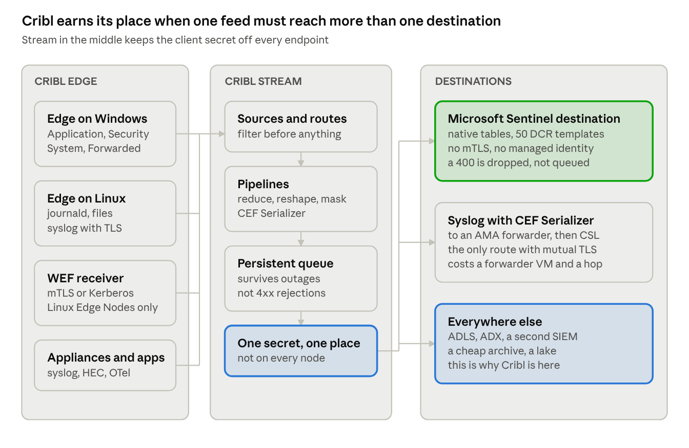

# Cribl Stream and Edge to Microsoft Sentinel

Cribl reaches Sentinel through the same Logs Ingestion API as everything else, with a better operational surface than Logstash and one fact that belongs in the risk register: Microsoft does not document Cribl as a collection path.

## When this path is right

Cribl exists for routing and reduction: one feed, many destinations, with filtering, sampling, reshaping and replay in between. In a Sentinel estate it earns its licence in four situations.

- **More than one destination for the same data.** Sentinel plus a cheap archive, Sentinel plus Splunk through a migration, Sentinel plus a lake you query separately.
- **A volume problem that ingest-time transformation cannot solve.** A DCR transformation can drop rows and columns. It cannot sample, aggregate, deduplicate, or route a reduced copy to one place and the full copy to another.
- **A migration.** Running two SIEMs in parallel without doubling the collection tier on every host.
- **Sources whose owners will not accept another Microsoft agent.** This is a political reason, and it is the most common one.

Where it is not the answer: a single-destination Sentinel estate collecting Windows and Linux. That is what the agent and DCRs are for, and inserting Cribl adds a licence, a cluster, and a secret to rotate, in exchange for nothing.

### The support answer, because someone will ask for it

Microsoft lists a connector called **Cribl** in the [data connectors reference](https://learn.microsoft.com/en-us/azure/sentinel/data-connectors-reference), and it is not what people assume when they see it. It ingests Cribl's *own internal logs* into `CriblInternal_CL` for self-monitoring. It is marked "Supported by: Cribl" and carries "Data collection rule support: Not currently supported". It is not a sanctioned route for third-party data, and citing it as one in a design document will not survive a careful reader.

The accurate framing, which is worth getting right because it differs from the Logstash answer:

> Microsoft supports the Logs Ingestion API and any client that speaks it correctly. Microsoft does not document or support Cribl as a collection path for Sentinel. Cribl supports its own destination.

That is a vendor-supported integration against a supported API — defensible, and not the same thing as a Microsoft-supported architecture. State it plainly rather than letting a risk owner discover it later.

## The architecture



The third destination box is the whole argument. If only the top one is ever used, the agent and a DCR do the same job with one fewer platform to license, staff and patch.

## The Sentinel destination

In both Stream and Edge the destination is called **Microsoft Sentinel**, and its header line reads `Type: Streaming | TLS Support: No | PQ Support: Yes`. Decode that middle value before anyone panics: transport is HTTPS, but there is no client-side TLS configuration surface — no mutual TLS, no custom CA, no pinning. A requirement for outbound mTLS cannot be met by this destination.

It speaks the Logs Ingestion API only. The older **Azure Monitor Logs** destination is the one that used the HTTP Data Collector API, and Cribl's own page now states: "The Azure Monitor Log Destination is now deprecated. The replacement for routing data to the Microsoft Log Analytics platform is the Microsoft Sentinel Destination." Treat it as dead — Microsoft's support for that API ended 14 September 2026.

### Endpoint

Two modes. Use **ID**:

- **Data collection endpoint** — `https://<name>.<id>.<region>.ingest.monitor.azure.com`
- **Data collection rule ID** — the immutable ID, not the resource name
- **Stream name** — must match the `streamDeclarations` key exactly, not the friendly table name

**A DCE has been optional since Stream 4.1.4.** A `kind: Direct` DCR carries its own ingestion URL, so a DCE resource is needed only for Private Link or restricted public access — and it costs more. Any guidance still presenting a DCE as mandatory is dated, and this is the single change most likely to make a Sentinel integration document wrong.

**URL** mode takes the full ingestion URL instead, overridable per event with the internal field `__url`. That is the documented way to fan out to several tables from one destination, at the cost of buffer memory per URL.

### Authentication

OAuth2 client credentials only. **No managed identity. No certificate.**

- Login URL `https://login.microsoftonline.com/<tenant>/oauth2/v2.0/token`, with `.us` and `.cn` variants for sovereign clouds
- Scope `https://monitor.azure.com/.default`
- Secret inline or from Cribl's secret store
- The Entra app needs **Monitoring Metrics Publisher** on the DCR

The asymmetry is worth flagging in a security review: Cribl's **Azure Data Explorer** destination supports client secret, stored secret *and* certificate. The Sentinel destination supports neither of the stronger options. On this one point the Logstash path is better — it does managed identity, including on Arc-enabled servers, which removes the long-lived secret entirely. If the control requirement is no static credentials on collector nodes, that is a real argument against this destination, and it should be raised before procurement rather than after.

### Batching, retries, queueing

| Setting | Default | What it means here |
| --- | --- | --- |
| Compress | gzip, on | buys bandwidth, not headroom — the 1 MB API limit applies compressed *and* uncompressed |
| Body size limit | 1000 KB | set to the API ceiling; the actual body may exceed it, so leave margin |
| Buffer memory limit | 5× max body size | per destination, and `__url` fan-out multiplies it |
| Flush period | 1 s | |
| Request timeout | 30 s | |
| Request concurrency | 5 | range 1 to 32 |
| Retry on | 408, 429, 5xx | `Retry-After` honoured when it is 180 s or less |
| Every other 4xx | **dropped** | including the 400 that a schema mismatch returns |

Persistent queue modes are Error, Backpressure and Always On; 5 GB by default, up to 1 TB, with strict ordering on. **Cribl.Cloud Enterprise caps it at a fixed 1 GB per PQ-enabled destination per Worker Process**, and only Mode, backpressure duration and Clear are tunable there — a hybrid Worker Group is the only way to change the rest.

The sentence to carry away: **the persistent queue protects you from the destination being down, not from the destination rejecting your schema.** That distinction is the subject of the capacity and failure section below.

## Native tables, and the templates Cribl ships

The default assumption — that a pipeline vendor can only write to custom `_CL` tables — has been wrong for a while, and Cribl has done the work to make the better option easy.

[`criblio/Cribl-Microsoft`](https://github.com/criblio/Cribl-Microsoft) ships **50 native-table ARM DCR templates**, in two variants: `DataCollectionRules(NoDCE)/` using `kind: Direct` with no DCE charge (DCR names capped at 30 characters, requires Stream 4.14 or later), and `DataCollectionRules(DCE)/` for the Private Link case (64-character names, needs a DCE).

Twelve of the fifty are ASIM tables — `ASimAuthenticationEventLogs`, `ASimNetworkSessionLogs`, `ASimProcessEventLogs`, `ASimDnsActivityLogs`, `ASimFileEventLogs`, `ASimRegistryEventLogs`, `ASimWebSessionLogs`, `ASimAuditEventLogs`, `ASimDhcpEventLogs`, `ASimUserManagementActivityLogs`, plus the two assessment-related ones. The rest cover `CommonSecurityLog`, `SecurityEvent`, `Syslog`, `WindowsEvent`, `Event`, `AzureActivity`, `AzureDiagnostics`, the AWS and GCP families, the Defender `Device*` tables and the Windows assessment families.

### The mechanism, which looks contradictory until you read a template

Cribl's material shows a stream called `Custom-CommonSecurityLog`; Microsoft's documentation says built-in tables use `Microsoft-` prefixes. Both are right, at different ends of the DCR. From the shipped `CommonSecurityLog.json`:

```json
{
  "kind": "Direct",
  "properties": {
    "streamDeclarations": {
      "Custom-CommonSecurityLog": { "columns": [ "157 columns, TimeGenerated among them" ] }
    },
    "dataFlows": [
      {
        "streams": [ "Custom-CommonSecurityLog" ],
        "destinations": [ "sentinelWorkspace" ],
        "transformKql": "source",
        "outputStream": "Microsoft-CommonSecurityLog"
      }
    ]
  }
}
```

The input stream is always `Custom-<Table>`. The `outputStream` is what lands it in the native table. Cribl's **Stream name** field must carry the input name, `Custom-CommonSecurityLog` — and a mismatch there does not produce an error, it produces nothing arriving.

The transformation is a pass-through `source` in the shipped templates, which means the mapping burden sits entirely in your Cribl pipeline. That is a choice you can reverse: putting the mapping in `transformKql` instead makes the DCR tolerant of a pipeline that renames a field, and it is the more robust arrangement for anything a regulator will ask about.

### The SOC Optimization Toolkit

Cribl's active investment here is no longer the older PowerShell DCR automation, which now sits under `deprecated/`. It is a **SOC Optimization Toolkit** delivered as a Cribl.Cloud App — installed through Apps, Add App, Import from File. It does DCR gap analysis against a Sentinel solution, proposes field mappings, then deploys `kind: Direct` DCRs, the Cribl destination and a generated pack. It also does DCR drift detection and `_CF` column grafts onto native tables, and includes a Splunk and QRadar detection-rule migration analyser.

Two constraints: it is **Cloud only** and will not install on a customer-managed Leader, which rules it out for a bank running Cribl on its own infrastructure. And its field mapping does coalesce-priority assignment into `TimeGenerated` — preferring `timestamp`, then `event_time`, then `rt` — which is the clearest statement anywhere that `TimeGenerated` is the pipeline's job, not the platform's.

## Cribl Edge as the agent on the host

Edge is the part that actually competes with the Azure Monitor Agent, and it is more capable on Windows than most people expect.

### Windows event logs

Native, and **Windows-only**: "Cribl Edge Workers support Windows Event Logs only when running on Windows, not on Linux." Channels include Application, Security, System, any other log, and **ForwardedEvents** with XML and JSON output.

The setting that matters: **Use Windows Tools off is the default and the right choice** — it reads through the Windows Event Log API directly. Switching it on shells out to PowerShell and `wevtutil.exe`, and that mode is deprecated and slated for removal. Polling interval and batch size apply only in the deprecated mode; Render Event Message Strings and Suppress Missing Event Log Errors only in API mode. Defaults are a 10-second poll, batch 500, and a 51,200-byte maximum event. Needs administrator, or Read on `HKLM\SYSTEM\CurrentControlSet\Services\EventLog`.

One limitation to design around: it is built for Overwrite-mode logs and may drop events on rotation or when a log is cleared. Cursors live in the KV store, keyed by log name.

### Windows Event Forwarding, which is the interesting one

Edge can act as a **WEF receiver**. Windows Event Collectors connect to a subscription-manager endpoint on the Edge Node, authenticating by **client certificate over mTLS**, by **Kerberos** with an SPN and keytab, or by Negotiate. For an estate that already runs WEF — and most banks do — this replaces the AMA-on-a-collector-VM pattern without touching the endpoints at all.

Two constraints that rule it in or out quickly: Kerberos and Negotiate work **only on x86_64 Linux Edge Nodes**, and **not on Cribl-managed Workers** — customer-managed Fleets only. The documentation does not state GA or preview status for this source, which is worth confirming with Cribl before it goes in a design.

### Linux

- **Journal Files** reads systemd journald, and **ships disabled by default**. Its default filter is `severity <= 4` — emergency through warning only — which silently discards notice and informational events. That default has caught people out; change it deliberately or document why you kept it. Current-boot-only is also on by default. Reads LZ4 and ZSTD journals.
- **File Monitor** for ordinary log files.
- **Syslog** over TCP and UDP with TLS, and **PROXY protocol v1 and v2** so source IPs survive a load balancer. Cribl warns that high-EPS UDP into Cribl.Cloud drops data — put a customer-managed hybrid Worker Group close to the senders.

Also present: Exec, System Metrics, System State, Kubernetes events, logs and metrics, Apple Unified Logs, OTel, SNMP traps, Prometheus scrape and remote-write, and the Splunk, Elastic, Datadog and Loki protocols — which is what makes Edge a credible single agent in a mixed estate.

### How it is managed

A **Leader Node** holds the configuration; managed Edge Nodes poll it every 10 seconds by default. A **Fleet** is a set of nodes sharing config, a **Subfleet** inherits from its parent and parent-level deploys cascade down, and **Mapping Rulesets** are the ordered filter list that assigns a node to a Fleet. Changes must be git-committed before they can be deployed, which gives you versioning, diffs and an audit trail by default — the same discipline the main playbook argues for with DCRs, enforced by the product.

Terminology, because it trips people in mixed rooms: Edge uses **Fleets**, Stream uses **Worker Groups**.

### Edge straight to Sentinel, or through Stream?

Edge has the Sentinel destination as a first-class destination; nothing forces a Stream hop. But going direct means every Edge Node needs its own egress to `*.ingest.monitor.azure.com` and `login.microsoftonline.com`, and its own copy of the Entra client secret. Given the destination has no managed identity option, that is a secret distributed to every endpoint.

Stream in the middle keeps the credential in one place, keeps the one-destination-per-DCR fan-out manageable, and gives you a point to apply reduction before egress. For anything above a handful of nodes, that is the right shape.

## The CEF and syslog route

There is a second way into Sentinel that avoids owning a DCR schema: emit CEF over syslog and let an AMA forwarder put it in `CommonSecurityLog`, exactly as described in the main playbook.

The pieces exist and compose cleanly, though neither Cribl page documents the other, so the composition is yours to assert:

1. **CEF Serializer function** builds `CEF:Version|Device Vendor|Device Product|Device Version|Device Event Class ID|Name|Severity|[Extension]` from seven header fields — each a constant or a JavaScript expression — plus key-value extension pairs. Its output field defaults to `_raw`.
2. **Syslog destination** sends `_raw`. TCP by default with full TLS configuration including **mutual TLS**, server certificate validation, SNI and min/max version; UDP with a 1500-byte default record limit. RFC 3164 and RFC 5424 are both supported; under 5424 it sends `event.structuredData` without validating it. TCP load balancing across weighted receivers with DNS re-resolution.
3. **AMA on the forwarder VM** picks it up on 514 and lands it in `CommonSecurityLog`.

Useful overrides: `__facility`, `__severity`, and `__syslogout`, which sends a fully custom message and bypasses all other formatting. Note that outbound syslog is **not compressed** — Cribl's compression setting applies only to persistent queue files on disk.

**When to actually use this.** Now that the 50 native-table templates exist, the direct Sentinel destination reaches `CommonSecurityLog` with no forwarder VM and no extra hop, and that is the better default. Keep the syslog route for three cases:

- the downstream collector is not Sentinel, or not only Sentinel
- a customer or a network team mandates a syslog demarcation point between zones
- you need mutual TLS on the wire, which the Sentinel destination cannot do and the Syslog destination can

That third one is not a small point. If the control requirement is mTLS from the pipeline outward, this route is the only way to satisfy it while still reaching `CommonSecurityLog` — the TLS terminates at your own forwarder rather than at Azure, which is usually what the control actually means.

## Capacity, and the failure mode nobody plans for

### The API's hard limits

| Limit | Value |
| --- | --- |
| Maximum size of an API call | **1 MB**, compressed *and* uncompressed |
| Maximum field value | **64 KB**, silently truncated beyond |
| Data per minute per DCR | **about 2 GB** |
| Requests per minute per DCR | **about 12,000** |

Gradual growth past these may be absorbed with temporary throttling, signalled by `Retry-After`. For a known step change — onboarding a large estate on a date — Microsoft asks to be contacted in advance, which is a lead time to put in the plan rather than discover.

One common misconception worth killing: the workspace daily volume-rate soft limit does **not** apply to DCR-based ingestion. The per-DCR numbers above are the ones that bind.

### Reconciling those with Cribl's defaults

The arithmetic is short and nobody does it:

- Body size limit **1000 KB** is set deliberately at the API ceiling, and Cribl warns the actual body may exceed the configured value because it adds bytes on write. At exactly 1000 you are riding the limit. Set it lower and leave margin.
- Gzip buys bandwidth and **no headroom**, because the 1 MB limit applies to the compressed payload too.
- Flush period 1 s × request concurrency 5 = **300 requests per minute per Worker Process**, against a 12,000 ceiling. Request count is not your binding limit.
- 1000 KB × 5 concurrent × 60 ≈ **293 MB per minute per Worker Process**. So roughly **seven Worker Processes saturate one DCR**. Plan DCR count against Worker Process count, not against source count — and remember `__url` fan-out multiplies buffer memory per destination.

### The failure mode

A DCR schema mismatch returns **HTTP 400**. Cribl retries 408, 429 and 5xx; **every other 4xx is dropped**. The persistent queue never sees it. So:

> The persistent queue protects you against Azure being unavailable. It does nothing at all against Azure rejecting your schema, which is the far more likely failure.

Cribl's own wording makes the exposure explicit: "Field names in your data must match the DCR schema, or fields may be dropped", and "if Stream name does not exactly match the table name in the template, data may fail to land in the expected Sentinel table". Combined with Microsoft's HTTP 400, the result is silent data loss — no error in the workspace, because nothing arrived to be wrong.

What actually mitigates it, in order:

1. **Put mapping in `transformKql`, not only in the pipeline.** A DCR transformation can rename, coalesce and default. A `streamDeclarations` mismatch cannot be recovered after the fact.
2. **Set Failed request logging to `Payload` or `Payload + Headers` during onboarding.** Sensitive headers are always redacted and you can allowlist safe ones. Turn it down afterwards.
3. **Set `TimeGenerated` explicitly in the pipeline.** Cribl's destination documentation says nothing about it, but the native-table templates declare it as a column and the transformation is a pass-through, so nothing downstream will produce it. The usual failure is a quiet fallback to ingestion time, which corrupts every timeline built on that source.
4. **Alert on the destination's failure metrics**, not on record counts in the workspace. By the time a volume query notices, the events are gone and unrecoverable.

### Version floor

**Do not run the Sentinel destination on Stream 4.20.0.** Defect `CRIBL-45304`, "Microsoft Sentinel Destinations fail to authenticate with Microsoft", was reported in 4.20.0 and resolved in 4.20.1. **4.20.1 is the minimum safe version** for this path. Two more worth knowing from the same list: `CRIBL-45467`, where a 4.20.0 Leader with 4.19.x Worker Nodes discarded every event reaching an Event Breaker — a real mixed-version upgrade hazard — and `CRIBL-32548`, data loss on the ADX destination when changing compression, closed as **will not fix**.

## Packs, OCSF, licensing and traps

### Packs

The Pack Dispensary is now the **Cribl Marketplace** and has no public listing to quote from, so check in-product through Add Pack. Three Sentinel-adjacent packs are documented in Cribl's own material, though that post was last edited in May 2024 and currency is unconfirmed: a **Microsoft Sentinel Common Security Log destination pack** that maps events into `CommonSecurityLog` fields by resolving an existing field, then the internal `__cef`, then the internal `__schema`; a **CEF source pack**; and a **Palo Alto Networks source pack**. The Sentinel one also circulates as a community GitHub repository, which suggests it is community-authored rather than Cribl-certified — the Marketplace does have a certification mechanism, so check the state of any pack before recommending it to a client.

More current than any of those: the SOC Optimization Toolkit generates a bespoke pack per Sentinel solution, with pipelines, routes, reduction rules, around forty field mappings and lookup CSVs. That is where Cribl has put its Sentinel effort since 2024.

### OCSF

There is **no OCSF pack and no OCSF serializer function** — nothing analogous to the CEF Serializer. OCSF support is AI-mediated, through the Copilot Editor, renamed **Pipeline Builder** in 4.20.3. Cribl's wording: it "is optimized for transforming data into the OCSF, UDM, and ECS schemas", and for OCSF it recommends the class for your data rather than making you choose. Schema support tracks the spec — OCSF 1.7 and 1.8 arrived in 4.19.0, 1.9 in 4.20.3.

The architectural read matters for anyone treating OCSF as a schema contract: this is a design-time assistant that writes a pipeline for you, not a runtime normalisation primitive. The output is an ordinary Cribl pipeline you own, review and version, which is auditable — but there is no declarative contract and no runtime validation against the spec. If OCSF conformance is a stated requirement, that gap belongs in the design, because the main playbook's ASIM route does give you a validated target and this does not.

### Licensing

Consumption-based, denominated in **Credits**, where one credit is one US dollar. Stream and Edge meter by **GB ingested**; Search by usage or by dataset size; Lake by volume stored. Cribl-managed Worker Groups add an infrastructure fee that varies by region.

| Tier | Volume | Worker Groups | Fleets | Support |
| --- | --- | --- | --- | --- |
| Free | up to **1 TB/day** | 1 | 1 | community |
| Standard | up to 5 TB/day | 1 | 1 | 8×5 |
| Enterprise | unlimited | unlimited | unlimited | 24×7 |

The Free tier at 1 TB/day is generous enough that a proof of value costs nothing but time. For customer-managed deployments the **Universal Subscription** converts Stream and Edge licences into credits spendable across any Cribl product.

One commercial term worth raising with procurement rather than discovering at renewal: on Cribl.Cloud, **no more than 20% of a year's purchased credits roll over**, the remainder is forfeited, and even that 20% survives only if you renew at least the same amount. No renewal means all unused credits are forfeited. Note also that Git backup is a Standard feature **not available in Cribl.Cloud**.

### Traps

1. **Stream 4.20.0 breaks Sentinel authentication.** `CRIBL-45304`. Floor the version at 4.20.1.
2. **The stream name is not the table name.** It must match the `streamDeclarations` key, which is `Custom-<Table>` even when the destination is a native table. A mismatch produces silence, not an error.
3. **A schema mismatch is a 400, and 400s are dropped.** The persistent queue does not catch them.
4. **`TimeGenerated` is the pipeline's job.** Cribl's destination documentation never says so.
5. **No managed identity and no certificate auth.** A static client secret on every sending node is the only option, so Stream in the middle rather than Edge direct is the containment pattern.
6. **No client-side TLS surface.** If mTLS outbound is mandated, use the syslog route or a different destination.
7. **The Azure Monitor Logs destination is deprecated** and runs on an API whose support ended in September 2026. Anyone still using it should be migrating now.
8. **A DCE is no longer required.** Carrying one from an old design adds cost and a Private Link assumption nobody made.
9. **Journal Files defaults to `severity <= 4`** and ships disabled. Both defaults silently reduce what you collect on Linux.
10. **Microsoft's "Cribl" connector is not this.** It is Cribl self-monitoring into `CriblInternal_CL`, with no DCR support.

### Sources

- [Cribl Stream: Microsoft Sentinel destination](https://docs.cribl.io/stream/destinations-sentinel/) and [the Sentinel use case](https://docs.cribl.io/stream/usecase-azure-sentinel/)
- [Azure Monitor Logs destination, deprecated](https://docs.cribl.io/stream/destinations-azure-monitor-logs/)
- [`criblio/Cribl-Microsoft` DCR templates and SOC Optimization Toolkit](https://github.com/criblio/Cribl-Microsoft)
- [Cribl Edge: Windows Event Logs](https://docs.cribl.io/edge/sources-windows-event-logs/), [Windows Event Forwarding](https://docs.cribl.io/edge/sources-wef/), [Journal Files](https://docs.cribl.io/edge/sources-journal-files/)
- [Cribl Edge fleet management](https://docs.cribl.io/edge/fleet-management/)
- [Syslog destination](https://docs.cribl.io/stream/destinations-syslog/) and [CEF Serializer function](https://docs.cribl.io/stream/cef-serializer-function/)
- [Copilot Editor and schema transformation](https://docs.cribl.io/stream/copilot-editor-pipelines)
- [Cribl pricing](https://cribl.io/pricing/) and [known issues](https://docs.cribl.io/llms-known-issues.txt)
- [Azure Monitor service limits](https://learn.microsoft.com/en-us/azure/azure-monitor/fundamentals/service-limits) and [Sentinel data connectors reference](https://learn.microsoft.com/en-us/azure/sentinel/data-connectors-reference)
