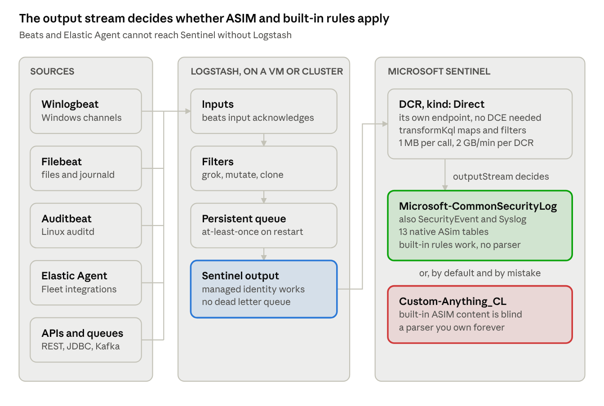

# Logstash and Beats to Microsoft Sentinel

Logstash is the one third-party collection path Microsoft documents and ships a plugin for, and that plugin is still public preview with no SLA. No Beat can reach Sentinel without it.

## When this path is right

Microsoft lists Logstash as one of six documented ways to build a custom connector, and states its fit as "on-premises and IaaS sources, any source for which a plugin is available, and organizations already familiar with Logstash". The last clause is the real criterion.

Logstash is not better than the Azure Monitor Agent at collecting Windows or Linux logs. It is better at the sources the agent cannot see at all: an appliance with only a REST API, a JDBC query against an application database, a Kafka topic, a message queue, a file format nobody else parses. And if the estate already runs Logstash for observability, the operators, the config discipline and the monitoring exist — adding a Sentinel output is a day's work rather than a new platform.

The second honest reason is a copy. Where a bank already pipes data into Logstash for the application teams, a `clone` filter plus a second output gets security its feed without re-instrumenting the source. That is usually cheaper than arguing for an agent on a machine someone else owns.

The agent stays the answer for Windows event channels, syslog, CEF, Linux files, and anything with a first-party connector. Routing those through Logstash buys nothing and costs a VM cluster to run it on — Microsoft notes the path is not serverless and "requires a VM or VM cluster".

Two status facts to carry into any design review, because they change the risk conversation rather than the architecture:

- The Sentinel output plugin is **public preview**. Microsoft's own wording: "provided without a service level agreement, and it's not recommended for production workloads." No GA date is published.
- Microsoft supports **only its own output plugin**. Every input, filter and codec in the pipeline is yours to support. The same page elsewhere claims Logstash "supports all capabilities of the Azure Monitor Agent", which contradicts the preview warning on the plugin's own page — expect that sentence to be quoted at you, and do not repeat it unqualified.

## The architecture



Everything left of the DCR is yours to run and support. Everything right of it behaves exactly as the agent path does, which is why the output stream is the decision that matters most: the same pipeline either feeds built-in content or feeds a table nothing can read.

## The output plugin

```bash
logstash-plugin install microsoft-sentinel-log-analytics-logstash-output-plugin
```

Current version is **2.5.1-java**, published 10 September 2026. Microsoft's own documentation page still says 2.5.0, which is the first sign that this page is not watched closely.

The trap that costs an afternoon: the plugin was rewritten from Ruby to Java at 2.0.0 and the parameter names changed. Almost every blog post, and a lot of internal runbook material, still shows the 1.x names. Both sets work — 2.2.0 added acceptance of either — but write the current ones.

| 1.x, Ruby, deprecated | 2.x, Java, current |
| --- | --- |
| `client_app_Id` | `client_id` |
| `client_app_secret` | `client_secret` |
| `dcr_immutable_id` | `dcr_id` |
| `dcr_stream_name` | `stream_name` |
| `tenant_id` | unchanged |
| `data_collection_endpoint` | unchanged |

**Managed identity works, and it is the most valuable thing in the 2.x rewrite.** Omit `client_id`, `client_secret` and `tenant_id` and the plugin uses `DefaultAzureCredential`, trying environment variables, then workload identity (AKS, `AZURE_FEDERATED_TOKEN_FILE`), then managed identity on an Azure VM, a scale set, or an **Azure Arc-enabled server**. On Arc the Logstash process must be a member of the `himds` group. The identity needs **Monitoring Metrics Publisher** on the DCR. For a bank, this removes a long-lived client secret from every collector VM — which is usually the objection that stops this path at the security review.

```ruby
input {
  beats { port => 5044 }
}

filter {
  # whatever shaping the source needs; the DCR transformation can finish the job
  mutate { rename => { "[@timestamp]" => "TimeGenerated" } }
}

output {
  microsoft-sentinel-log-analytics-logstash-output-plugin {
    # no client_id / client_secret / tenant_id: managed identity is used
    data_collection_endpoint => "https://dcr-xxxx.westeurope-1.ingest.monitor.azure.com"
    dcr_id                   => "dcr-00000000000000000000000000000000"
    stream_name              => "Custom-CommonSecurityLog"
    max_batch_size           => 10000
    input_queue_capacity     => 50000
    max_retries_num          => 3
    connect_timeout_seconds  => 15
    write_timeout_seconds    => 60
    # low-volume sources: raise both of these or events sit in the plugin's buffers
    max_waiting_time_for_batch_seconds    => 60
    max_waiting_for_unifier_time_seconds  => 60
  }
}
```

Build the DCR's `streamDeclarations` from real data rather than guessing: set `create_sample_file => true` and `sample_file_path`, run the pipeline briefly, and the plugin writes `sampleFile<epoch>.json` with ten records. Note that it adds `ls_timestamp` and `ls_version` columns, which must then appear in the declaration.

Other parameters worth knowing: `azure_cloud` (`AzurePublicCloud` by default, plus Government, China and Germany), `proxy` / `proxy_aad` / `proxy_endpoint` added in 2.5.0 and scoped to the plugin — an empty string unsets a system-wide proxy for this output only — and `keys_to_keep` to drop everything else before sending.

**There is no compression setting and no dead letter queue setting.** Gzip happens inside the Azure SDK, not as a knob. The missing DLQ is the subject of a section of its own below.

Firewall: service tags **AzureMonitor** and **AzureActiveDirectory**, or allow `login.microsoftonline.com` and the ingestion host on 443 outbound — and without TLS inspection, which breaks the SDK's certificate validation.

## The DCR, and why the destination should not be a `_CL` table

Create the DCR with `"kind": "Direct"`. It then exposes its own `properties.endpoints.logsIngestion` URI, which is what the plugin's `data_collection_endpoint` parameter wants — so no separate DCE resource is needed unless the workspace sits behind Private Link. Endpoints cannot be added to an existing DCR, so a non-Direct rule you inherited will need a DCE for as long as it exists.

Two Microsoft pages disagree about this and it is worth knowing which is which. The plugin page lists `data_collection_endpoint` as required and puts a DCE in its firewall table; the [Data Collection Endpoint overview](https://learn.microsoft.com/en-us/azure/azure-monitor/data-collection/data-collection-endpoint-overview) says you do not need a DCE if you use the DCR's own endpoint. Both are correct: the *parameter* is mandatory, the *resource* is not.

### The part most guidance gets wrong

**104 tables now accept the Logs Ingestion API**, not only custom `_CL` tables. The ones that matter here:

- `CommonSecurityLog`, `SecurityEvent`, `Syslog`, `WindowsEvent`, `Event`
- all thirteen native ASIM tables: `ASimAuthenticationEventLogs`, `ASimNetworkSessionLogs`, `ASimProcessEventLogs`, `ASimDnsActivityLogs`, `ASimFileEventLogs`, `ASimRegistryEventLogs`, `ASimWebSessionLogs`, `ASimAuditEventLogs`, `ASimDhcpEventLogs`, `ASimUserManagementActivityLogs`, `ASimAlertEventLogs`, `ASimAgentEventLogs`, `ASimAssetEntityLogs`
- `ThreatIntelIndicators`, `ThreatIntelObjects`, `DnsAuditEvents`, `Anomalies`, plus the AWS, GCP, CrowdStrike and SAP ABAP families

The generated list is in the [table features reference](https://learn.microsoft.com/en-us/azure/azure-monitor/reference/tables-features).

This is the most consequential decision on the page. Data landing in a `_CL` table is invisible to built-in ASIM content and to every ASIM-based analytic rule template until someone writes a source-specific parser and registers it with the `_Im_<schema>` unifying parsers. Target `Microsoft-ASimNetworkSessionLogs` instead and you get ASIM normalisation with no parser at all. Sending a firewall feed from Logstash into `FirewallLogs_CL` is a decision to do parser work forever, taken by accident.

### The mechanism

Easy to misread, because the input and output stream names are different shapes: the input stream is always `Custom-<something>`, and the output stream is what routes it into a built-in table.

```json
{
  "kind": "Direct",
  "location": "westeurope",
  "properties": {
    "streamDeclarations": {
      "Custom-CommonSecurityLog": {
        "columns": [
          { "name": "TimeGenerated", "type": "datetime" },
          { "name": "DeviceVendor", "type": "string" },
          { "name": "DeviceProduct", "type": "string" },
          { "name": "Activity", "type": "string" },
          { "name": "SourceIP", "type": "string" },
          { "name": "DestinationIP", "type": "string" }
        ]
      }
    },
    "destinations": {
      "logAnalytics": [
        {
          "name": "sentinelWorkspace",
          "workspaceResourceId": "/subscriptions/<sub>/resourceGroups/<rg>/providers/Microsoft.OperationalInsights/workspaces/<ws>"
        }
      ]
    },
    "dataFlows": [
      {
        "streams": [ "Custom-CommonSecurityLog" ],
        "destinations": [ "sentinelWorkspace" ],
        "transformKql": "source",
        "outputStream": "Microsoft-CommonSecurityLog"
      }
    ]
  }
}
```

`transformKql` applies on this path exactly as it does on the agent path, so the whole ingest-time transformation story from the main playbook is available: filtering before billing, column mapping, tier routing. It is also where `TimeGenerated` comes from if the pipeline does not already produce it — the API requires the column and nothing downstream will invent it.

Column rules that reject a deployment: names start with a letter and run to 45 characters of alphanumerics and underscores; `_ResourceId`, `id`, `_SubscriptionId`, `TenantId`, `Type`, `UniqueId` and `Title` are reserved; a custom column added to a built-in Azure table needs a `_CF` suffix. The DCR itself is capped at 20 data flows, 20 stream declarations, 10 workspaces, and a transformation of 15,360 characters.

## Beats and Elastic Agent

The fact that decides the architecture: **no Beat can write to Sentinel or Log Analytics.** The supported output list is identical across Filebeat, Winlogbeat, Auditbeat and Metricbeat — Elasticsearch, Logstash, Kafka, Redis, File, Console, Discard — and only one output may be configured at a time. There is no Azure Monitor output, and there never has been. Elastic Agent is the same: Elasticsearch, Kafka, Logstash.

So Logstash is not an optional hop on this path. It is the only bridge, and the alternative — Kafka plus a consumer you write — is not a documented route and becomes your software to maintain.

| Collector | Collects | Reaches Sentinel via |
| --- | --- | --- |
| Winlogbeat | Windows event channels, including ForwardedEvents | Logstash |
| Filebeat | files, journald, syslog, many modules | Logstash |
| Auditbeat | Linux auditd, file integrity | Logstash |
| Elastic Agent | the Fleet integrations catalogue | Logstash |

**Beats are not deprecated, whatever a migration guide implies.** The `elastic/beats` repository still lists Auditbeat, Filebeat, Heartbeat, Metricbeat, Packetbeat, Winlogbeat and Osquerybeat as officially supported. Elastic's comparison page recommends Fleet-managed Elastic Agent "for most users" while stating that "some functionality gaps are being addressed as we strive to reach feature parity" and that if Agent does not fit, "you should continue using Beats". There is a Winlogbeat-to-Elastic-Agent migration guide, but that is a recommendation, not an end of life. Anyone who tells a change board that Winlogbeat is deprecated is wrong, and the correction is on Elastic's own page.

The dates that do exist are the shared Core Stack ones, and Logstash and Beats sit in the same row: **8.x end of maintenance 15 January 2027, end of support 15 July 2027; 9.x end of maintenance 15 October 2027** or eighteen months after 10.0, whichever is later. Those are the dates for a lifecycle slide, not a deprecation claim.

One detail that matters for loss: Beats and the HTTP input use a request-response protocol and therefore acknowledge receipt, so Logstash's persistent queue genuinely protects them. A `syslog`, `tcp` or `udp` input does not — Elastic states plainly that those "do not have a mechanism to acknowledge receipt". A syslog listener in front of Logstash is lossy no matter how the queue is configured, which is an argument for Winlogbeat or Filebeat on the host rather than a syslog relay into the pipeline.

## Delivery guarantees, and the dead letter queue that is not there

This is the section to read before committing a regulated log source to this path, because the gap is real and it is not in the Microsoft documentation.

**Turn on the persistent queue.** Logstash defaults to `queue.type: memory`, which means an abnormal restart loses whatever was in flight. With `persisted`, Elastic's wording is "at least once" — an event is acked only when the pipeline has processed it completely, and unacked batches are reprocessed after an abnormal termination. Expect duplicates, not loss. Defaults worth changing: `queue.max_bytes` 1024mb, `queue.page_capacity` 64mb, `queue.checkpoint.writes` 1024. Setting `queue.checkpoint.writes: 1` maximises durability and, in Elastic's own words, "can severely impact performance".

The limits Elastic states plainly, which belong in a design document rather than being discovered later: data may be lost if an abnormal shutdown happens before the checkpoint file is committed; the queue "does not handle permanent machine failures such as disk corruption, disk failure, and machine loss"; the data is not replicated; NFS is unsupported. A persistent queue is a restart guarantee, not a durability guarantee.

**The gap.** Logstash's dead letter queue is, verbatim, "currently supported only for the Elasticsearch output and conditional statements evaluation". The Sentinel output plugin therefore cannot use it, and has no DLQ setting of its own. When the Logs Ingestion API rejects a batch with HTTP 400 — which is what a schema mismatch against the DCR's `streamDeclarations` returns — the plugin retries `max_retries_num` times, logs the failure, and drops the events. Nothing holds them. Nothing replays them.

Version 2.5.1 improved the diagnostics and not the outcome: it logs the inner HTTP status, the Azure error code and message, `x-ms-request-id`, `x-ms-client-request-id` and the SDK's count of failed logs. It deliberately does not log the failed payloads, so you learn that events were lost and not which ones.

What to do about it, in order of how much it actually helps:

1. **Make the DCR tolerant instead of the pipeline exact.** Put mapping in `transformKql` rather than relying on the pipeline to emit field names that match the declaration byte for byte. A transformation can rename, coalesce and default; a mismatch in the declaration cannot be recovered.
2. **Declare generously.** A column in `streamDeclarations` that the pipeline does not always populate costs nothing. A field the pipeline sends that is not declared is where the 400s come from.
3. **Alert on the plugin's own failure logs**, not on record counts in the workspace. By the time a `Heartbeat` or volume query notices, the events are gone. Ship Logstash's logs somewhere and alert on the Azure error codes.
4. **Tee to durable storage for the sources that matter.** A second output writing to disk or to blob storage, retained for a few days, is the only honest replay mechanism on this path. For a source that has to survive a regulator's question about completeness, this is not optional.

The tuning knobs, for completeness: `pipeline.workers` defaults to the host's core count, `pipeline.batch.size` to 125, `pipeline.batch.delay` to 50 ms, and the in-flight count is the product of workers and batch size. Setting workers above core count can help here, because the output spends its time in I/O wait. Elastic publishes no throughput figures for Logstash, so size it by measurement on your own data and ignore any number quoted at you.

## Licensing, and the traps

### What legal will ask

The 2024 AGPL relicensing applied to Elasticsearch and Kibana, **not** to Logstash or Beats. Both of those carry the same `LICENSE.txt`: Apache 2.0 outside the `x-pack` folder, Elastic License inside it. The catch is practical rather than legal — the default downloadable distributions bundle x-pack and are therefore governed by the **Elastic License 2.0**. Only the `-oss` artifacts were pure Apache 2.0, and Elastic stopped publishing those after 7.x. So "we are using the Apache-licensed build" is not true of anything downloaded today.

The plugin's own licence is declared inconsistently: the 2.5.1 gemspec says Apache-2.0, the RubyGems page (still showing 1.1.4) says MIT. Flag both rather than picking one.

### Traps

1. **The 1.x parameter names are everywhere.** `client_app_Id` and `dcr_immutable_id` still work, which is worse than if they failed — copied config keeps working and nobody learns the names changed at 2.0.0.
2. **Microsoft's own shipped connectors use the deprecated plugin.** The Sentinel **Elastic Agent** connector, marked "Supported by: Microsoft Corporation", instructs you to install `microsoft-logstash-output-azure-loganalytics` with `workspace_id` and `workspace_key`, land in `ElasticAgentEvent`, and parse with a KQL function — and that table is marked "Data collection rule support: Not currently supported". The **Cisco SD-WAN** connector does the same. Both use the HTTP Data Collector API, whose support ended **14 September 2026**. Do not follow those connector instructions for anything new.
3. **The old API is end-of-support, not switched off.** Microsoft's wording is precise and people misquote it in both directions: "Support ended for the legacy Data Collector API September 14, 2026, although ingestion continues to function." Separately, on **1 March 2026** the endpoint stopped accepting TLS below 1.2. So a legacy pipeline probably still works, has no support, and cannot use Private Link at all. Migrate it; do not panic about it.
4. **`TimeGenerated` is yours to produce.** The API requires it. If neither the pipeline nor `transformKql` sets it from the real event time, you get ingestion time, and every incident timeline built on that source is quietly wrong.
5. **Low-volume sources look broken.** With the default ten-second batch and unifier waits, a source emitting a few events a minute sits in the plugin's buffers long enough that people conclude the pipeline is dead. Raise both waits to 60 seconds or more.
6. **TLS inspection breaks it.** The Azure SDK validates the certificate chain. An inspecting proxy in the path produces authentication failures that look like credential problems.
7. **A syslog input undoes the persistent queue.** Covered above, and worth repeating because it is the most common way a "durable" Logstash pipeline loses data.
8. **The DCR name and the stream name are not the table name.** The stream must match the `streamDeclarations` key exactly. A mismatch does not error — data simply does not arrive.

### Sources

- [Connect Logstash to Microsoft Sentinel with the DCR-based plugin](https://learn.microsoft.com/en-us/azure/sentinel/connect-logstash-data-connection-rules)
- [Resources for creating Microsoft Sentinel custom connectors](https://learn.microsoft.com/en-us/azure/sentinel/create-custom-connector)
- [Plugin source and changelog](https://github.com/Azure/Azure-Sentinel/blob/master/DataConnectors/microsoft-sentinel-log-analytics-logstash-output-plugin_java/README.md)
- [Logs Ingestion API overview](https://learn.microsoft.com/en-us/azure/azure-monitor/logs/logs-ingestion-api-overview)
- [Migrate from the HTTP Data Collector API](https://learn.microsoft.com/en-us/azure/azure-monitor/logs/custom-logs-migrate)
- [Tables that support the Logs Ingestion API](https://learn.microsoft.com/en-us/azure/azure-monitor/reference/tables-features)
- [Logstash persistent queues](https://www.elastic.co/docs/reference/logstash/persistent-queues) and [dead letter queues](https://www.elastic.co/docs/reference/logstash/dead-letter-queues)
- [Beats and Elastic Agent comparison](https://www.elastic.co/docs/reference/fleet/beats-agent-comparison) and [Elastic end-of-life policy](https://www.elastic.co/support/eol)
